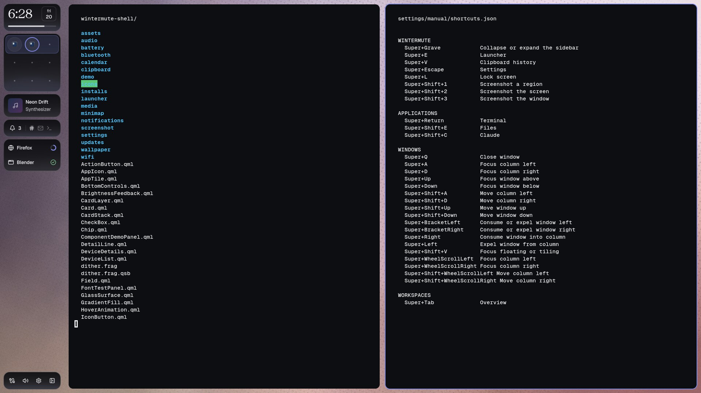
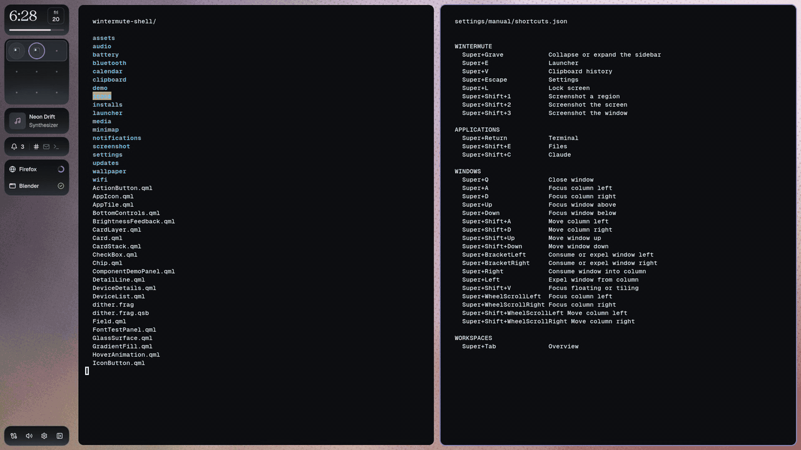
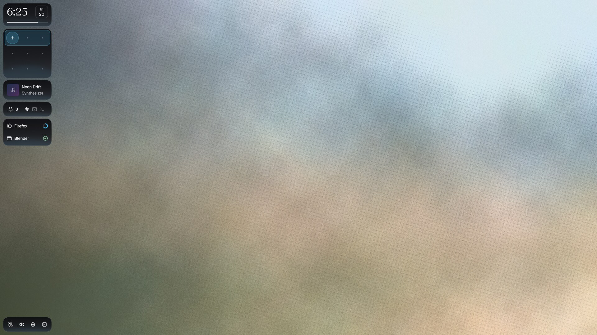
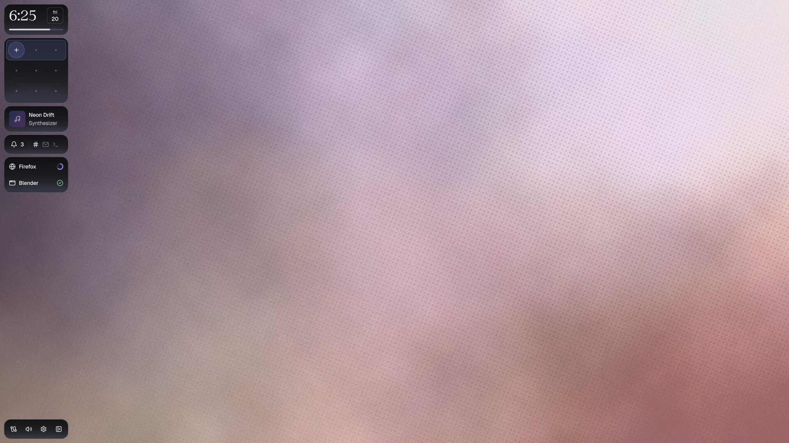
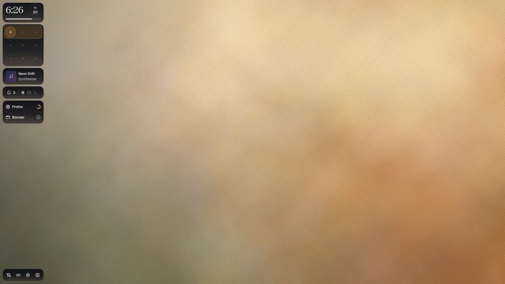
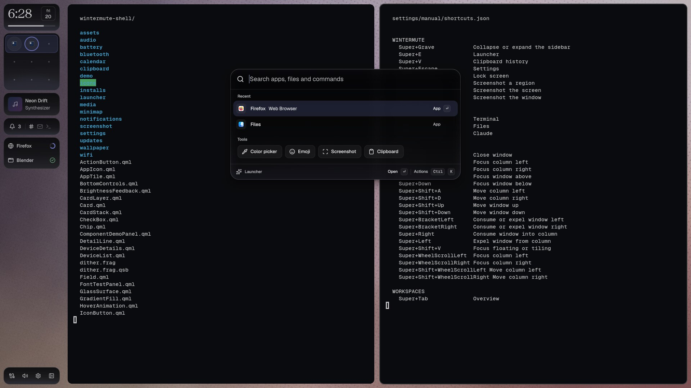
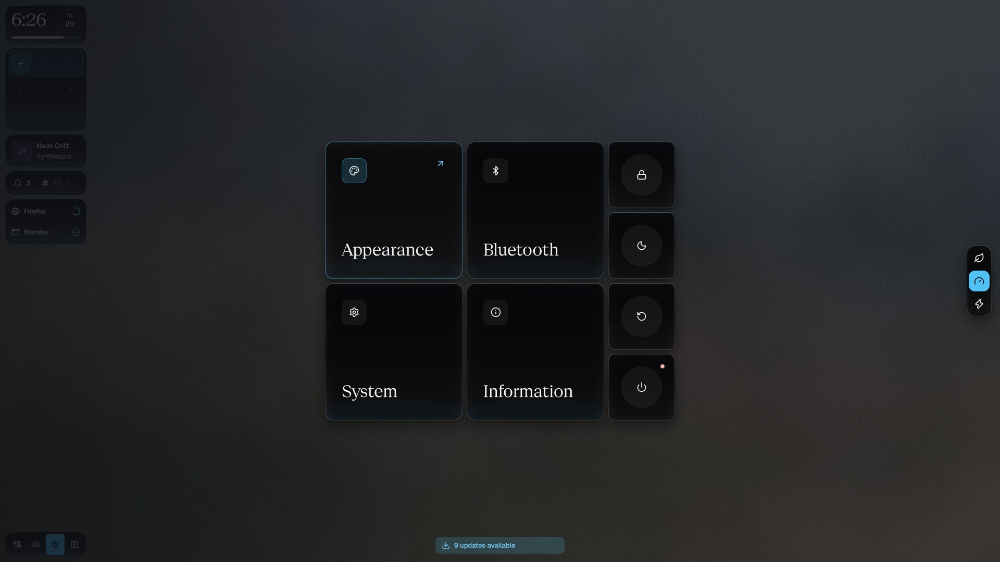
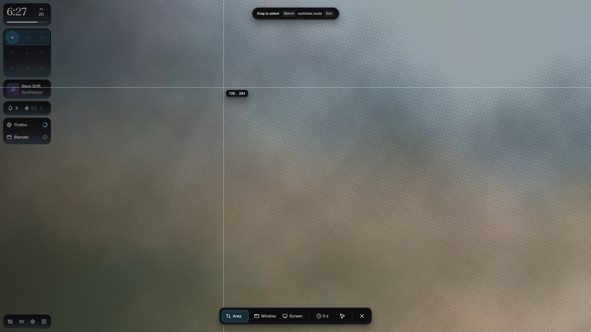
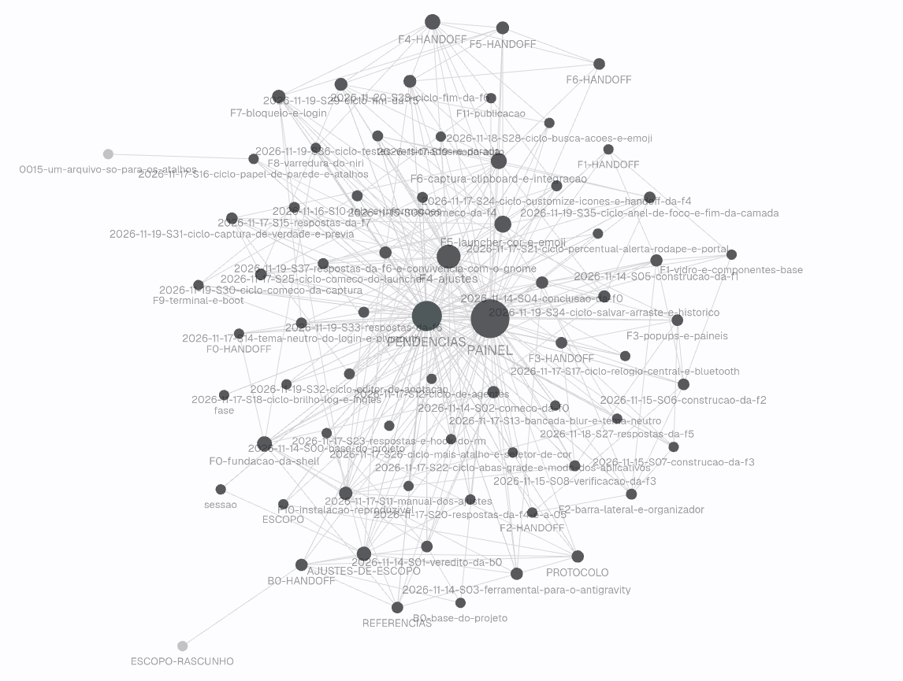

# Wintermute Shell

A desktop shell for the [Niri](https://github.com/niri-wm/niri) compositor, written in QML on [Quickshell](https://quickshell.org): a glass sidebar with a workspace organizer, stacked panels, a settings app, a launcher with a colour picker and an emoji picker, screen capture with annotation, and a clipboard history. This repository holds the shell, its design record, and the workflow I used to build it.



> **Status: paused on 2026-11-20.** I built this in one week (14 to 20 November 2026) as the desktop for a CachyOS + Niri installation and stopped during the live QA of the last construction phase, because I am moving to Fedora with GNOME. Most of the shell passed my live testing; screen capture did not. The [status](#status) section says exactly what works, what was never validated and what is broken. There is no installer.



*A 40-second recording of the running shell on Niri, driven over IPC. The same clip in better quality: [tour.mp4](docs/showcase/assets/live/tour.mp4).*

## What is in it

| Area | What it does |
|---|---|
| **Sidebar** | Clock and battery, a workspace organizer that mirrors Niri's workspaces and windows, media, notifications, installs and updates, and the bottom controls. Collapses from 156 px to 48 px. |
| **Panels** | Wi-Fi, Bluetooth and sound as stacked cards that open beside the bar; calendar, battery, notification centre and toasts; volume, brightness and keyboard-layout OSDs. |
| **Settings** | A home screen with session buttons, tray and power profiles; mouse and touchpad, lock and sleep, keyboard layouts, displays and arrangement, system information, an animated manual of shortcuts, appearance, and a wallpaper picker with per-mode and per-monitor choices. |
| **Launcher** | Apps, files, settings pages and session commands in one search, with a calculator, an actions menu, a colour picker with a magnifier, an emoji picker (1,914 emoji, searchable in English and Portuguese) and the clipboard history. |
| **Capture** | Area, window and screen modes over a frozen frame, an annotation editor, save and copy, and a preview in the sidebar that can be dragged into other apps. |
| **Niri integration** | The shell reserves its own zone, writes the focus ring in the accent colour and the window gaps into a Niri include file, and generates Niri's keybindings from the same list the manual shows. |

The look is called **Armitage**: always dark, glass surfaces, and three variations that change only the accent colour.

| Chiba | Freeside | Sprawl |
|---|---|---|
|  |  |  |

| Launcher over windows | Settings | Screen capture |
|---|---|---|
|  |  |  |

These screenshots were taken live on Niri, on an empty workspace, with the sidebar's demo cards switched on so no real data shows. The **[showcase](docs/showcase/README.md)** has every piece in every state.

## Status

| Phase | Delivery | Result |
|---|---|---|
| B0 | Repository, contracts and project panel | Go |
| F0 | Starting code, theme, fonts, icons, shell opening on Niri | Go |
| F1 | Glass and base components | Go |
| F2 | Sidebar and workspace organizer | Go |
| F3 | Pop-ups and panels | Go |
| F4 | Settings | Go (live QA, 2026-11-20) |
| F5 | Launcher, colour picker and emoji | Go (live QA, 2026-11-20) |
| F6 | Capture, clipboard history and Niri integration | Live QA interrupted, no verdict |
| F7–F11 | Lock and login screens, Niri config sweep, terminal and boot, installer, publication | Not started |

**What I validated live on Niri:** everything from F0 to F5, step by step. From F6, only opening the capture and selecting an area, and the Niri integration as far as I measured it: the 12 px edge gap from the include file the shell writes, and that file being rewritten with the new accent when I switch variation.

**What I never validated:** most of F6. The capture's window and screen modes, the annotation editor, saving, the sidebar preview and its drag, the clipboard history, and copy and paste between Wayland and XWayland apps were built and passed bench QA, but the live session stopped before I walked through them.

**What is broken:**

- **Quickshell can crash when the capture overlay or the colour-picker magnifier is used with a real pointer on two monitors.** Six crashes in one session, all segfaults inside Qt Wayland (`QWaylandWindow::handleScreensChanged`). The first one came right after I closed the capture over IPC, but ten deliberate open-and-close rounds over IPC afterwards never reproduced it, and my one attempted workaround did not hold. The cause is open.
- **Capture's window mode cannot highlight tiled windows**, because Niri's IPC returned no position for them.
- **Lock and sleep do nothing**: the lock screen belonged to a phase that never started.
- **Niri needs a few lines the repository does not ship yet** (a transparent layout background and a layer rule), or the wallpaper shows black. They are listed in the [shell readme](wintermute-shell/README.md).

## Running it

Inside a Niri session, with Quickshell installed, from the repository root:

```bash
qs -p wintermute-shell
```

Requirements, IPC commands, the keybinding generator, the optional C++ plugin and what the shell needs from Niri are in the [shell readme](wintermute-shell/README.md). I developed against Niri 26.04 and Quickshell 0.3.2 on CachyOS.

## How it was built

I ran this project as an experiment in method as much as in code:

- **Phases with a gate.** Each phase ends in a handoff with a test script, and only I give the Go or NoGo, live, on Niri.
- **A design record as the source of truth.** Every colour, measure, radius and duration comes from a token or a design card; a lint rejects values written straight into a component.
- **A project panel outside the repository**, in Obsidian: scope, phases, sessions, handoffs and open questions, so no session depends on the memory of the previous one.
- **A cycle of agents with separate roles**: an orchestrator that plans and reviews, an implementer, an independent QA agent that never sees the implementation, and a gate script that decides when the cycle must stop and wait for me.



The **[agent workflow](docs/agent-workflow/README.md)** documents all of it, including [what it got wrong](docs/agent-workflow/lessons.md): the bench approved every piece, and the first live session still found a black wallpaper, a flickering panel, a capture UI drawn underneath its own frame, and the crash above.

In numbers: 236 QML files and about 31,000 lines, 20 design cards, 18 decision records, 15 pure libraries with 447 versioned test cases, and around 200 commits in one week.

## Repository map

```
dotfiles/
├── wintermute-shell/      The shell (Quickshell/QML), with its own readme
├── niri/                  Reserved for the Niri configuration (never collected)
├── docs/
│   ├── showcase/          Visual catalogue of every piece (English)
│   ├── agent-workflow/    How the project was run (English)
│   ├── design/            Design cards and tokens: the visual source of truth (Portuguese)
│   └── decisoes/          Decision records with their reasons (Portuguese)
├── .agents/               Shared agent tooling: skills, scripts, bench, tests
├── .claude/               Subagent definitions and permissions
├── AGENTS.md              The working contract every agent session followed (Portuguese)
└── CLAUDE.md
```

The presentation layer is in English. The working record (decisions, design cards, contracts, code comments) stays in Portuguese, the language I thought and decided in; [decision 0018](docs/decisoes/0018-pausa-e-apresentacao-em-ingles.md) explains why. The [docs index](docs/README.md) lists every decision with its title in English.

## Licences and acknowledgements

This repository is distributed under the BSD-3-Clause licence. See [LICENSE](LICENSE).

- **Pond** (Butterfly Interaction, Inc.): Pond's interface is the design and behaviour reference for Wintermute Shell, and the shell's code starts from the code of Pond's interface, distributed under BSD-3-Clause. The original copyright notice and licence accompany the derived code.
- **Lucide**: icons, ISC licence.
- **Geist, Geist Mono and Geist Serif**: typography, SIL Open Font License 1.1.
- **Unicode**: the emoji list (Emoji 17.0) and the English and Portuguese names (CLDR 48) used by the emoji picker, Unicode License V3. A copy of the licence accompanies the data in `wintermute-shell/launcher/emoji/`.
- **Niri** and **Quickshell**: the compositor and the toolkit the shell runs on.
- **Claude Code** (Anthropic): this project was built with Claude Code as a coding agent.
