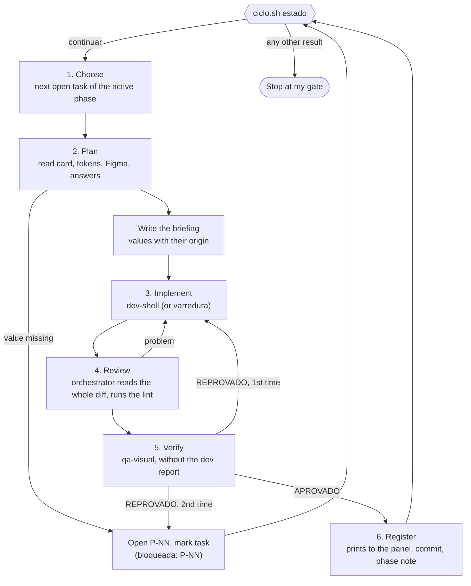

# How this project was run

Wintermute Shell was built in one week, from 2026-11-14 to 2026-11-20, with coding agents doing most of the typing and me holding the decisions. This folder documents the method: the agent structure, the gates, and the project panel I kept in Obsidian.

| Page | What it covers |
|---|---|
| This page | Phases, roles, one cycle step by step, the gate script, the design rules, the test tooling, the numbers |
| [obsidian-panel.md](obsidian-panel.md) | The panel: its notes, the session protocol, pending questions, handoffs and live QA |
| [lessons.md](lessons.md) | What worked, what did not, and what the first live session found |

The working record of the project is in Portuguese and stays that way: the agent contract ([`AGENTS.md`](../../AGENTS.md)), the decisions ([`docs/decisoes/`](../decisoes/README.md)), the design cards ([`docs/design/`](../design/README.md)) and the original workflow note ([`docs/fluxo-de-trabalho.md`](../fluxo-de-trabalho.md)). These three pages are the English summary. Naming the tools here (Claude Code, Antigravity, Obsidian, Figma) is a deliberate exception to my own attribution rule, recorded in [decision 0018](../decisoes/0018-pausa-e-apresentacao-em-ingles.md).

The project is paused. The state it was left in is described under [Phases](#phases-and-the-gonogo-gate) and in [lessons.md](lessons.md).

## Why a workflow at all

The problem I wanted to solve was continuity. In long projects, every work session starts without knowing exactly where the previous one stopped, and things that were decided or postponed get lost. With agents this gets worse: a new session has no memory at all, and a confident summary of "what was done" is not the same as what is actually on disk.

The answer has three parts ([decision 0004](../decisoes/0004-painel-no-obsidian.md)):

1. **A scope that never changes.** One document says what I wanted at the start. Changes go to a separate, append-only log.
2. **Phases with a gate.** No phase advances on its own. It ends in "waiting for QA", and the verdict is mine.
3. **A panel that always describes the real state.** A session is only over when the panel is true. Nothing stays only in the conversation.

Everything else on this page was added later, on top of these three, when the bottleneck moved from "losing track" to "I am the trigger for every session".

## The pieces at a glance

| Piece | Where | Role |
|---|---|---|
| Agent contract | [`AGENTS.md`](../../AGENTS.md), [`CLAUDE.md`](../../CLAUDE.md) | Rules every agent reads before acting: voice, session protocol, gates, design rules, git |
| Project panel | `~/Documents/Journal/projeto-dotfiles/` (Obsidian vault, outside the repo) | State, tasks, session reports, pending questions, handoffs |
| Project skills | [`.agents/skills/`](../../.agents/skills/) | `/retomar` (open a session), `/encerrar-sessao` (close it), `/qa-fase` (prepare and record QA), `/ciclo` (run the agent cycle) |
| Subagents | [`.claude/agents/`](../../.claude/agents/) | `dev-shell`, `qa-visual`, `varredura` |
| Scripts | [`.agents/scripts/`](../../.agents/scripts/) | Gate, bench, headless test screen, provenance lint, test runner |
| Hooks | [`.agents/hooks/`](../../.agents/hooks/) | Session-start state injection, write and delete fences for subagents |
| Permissions | [`.claude/settings.json`](../../.claude/settings.json) | What runs without asking, what always asks, what is denied |
| Design source | [`docs/design/`](../design/README.md) | Tokens and one card per piece: the visual truth in text |
| Decisions | [`docs/decisoes/`](../decisoes/README.md) | One record per lasting decision, with the reason |

## Phases and the Go/NoGo gate

The project is split into thirteen phases. Each one is small enough to be evaluated in one sitting. A phase ends in `aguardando QA` (waiting for QA) with a handoff that contains a test script; I open the Niri session, follow the script and say Go or NoGo. An agent records my verdict with the date and my exact words, and never marks `go` by itself. NoGo opens a numbered subphase (`F2.1`) with one task per problem.

| Phase | Delivers | Tasks done | Final state |
|---|---|---|---|
| B0 | Repository, contracts, panel | 14 | `go` (2026-11-14) |
| F0 | Shell foundation: starting code, theme, fonts, icons, shell opening on Niri | 11 | `go` (2026-11-14) |
| F1 | Glass surface and base components | 9 | `go` (2026-11-15) |
| F2 | Sidebar and workspace organiser | 12 | `go` (2026-11-15) |
| F3 | Pop-ups and panels | 12 | `go` (2026-11-15) |
| F4 | Settings | 25 | `go` (2026-11-20) |
| F5 | Launcher, colour picker and emoji | 13 | `go` (2026-11-20) |
| F6 | Screen capture, clipboard and desktop integration | 20 | QA interrupted, no verdict |
| F7 | Lock screen and login screen | 0 of 11 | not started |
| F8 | Niri configuration collected into `niri/` | 0 of 7 | not started |
| F9 | Terminal and boot | 0 of 7 | not started |
| F10 | Reproducible installation | 0 of 8 | not started |
| F11 | Publication | 0 of 9 | not started |

Two things about the gate changed along the way, both as recorded scope adjustments rather than silent drift:

- **Batch live QA (adjustment A-03).** For F4, F5 and F6 the next phase was allowed to start while the previous one waited for QA, and the three were evaluated together in a single Niri session at the end of F6. This is what let the agent cycle run for days without me. It is also the decision with the highest price; see [lessons.md](lessons.md).
- **Pieces without a Figma board (adjustment A-05).** When a piece or state had no drawing, the agent composed it from components and tokens the shell already used, wrote the composition into the design card, and I approved it from the print. Still no value without an origin.

## Roles

B0 to F3 and six tasks of F4 were built in ordinary sessions: I opened one, typed `/retomar`, the agent worked, `/encerrar-sessao` closed it. From 2026-11-17 on, the project moved through the agent cycle ([decision 0014](../decisoes/0014-ciclo-de-agentes.md)), with short ordinary sessions in between where I answered pending questions. The cycle exists only in Claude Code because it depends on subagents with their own model.

| Role | Who | Model | May | May not |
|---|---|---|---|---|
| Orchestrator | The main session, running `/ciclo` | Fable, effort high | Choose the task, take values from the design cards, write the briefing, review the diff, commit, write to the panel | Mark a phase `go`, push, install, write to `~/.config/` |
| Implementer | [`dev-shell`](../../.claude/agents/dev-shell.md) | Sonnet, effort high, up to 150 turns | Edit code inside the repository, run the lint, the bench and the tests | Commit, write outside the repository, spawn agents, estimate a missing value |
| Verifier | [`qa-visual`](../../.claude/agents/qa-visual.md) | Sonnet, effort high, up to 80 turns | Read the diff, run the lint and the bench, measure prints, return `APROVADO` or `REPROVADO` with evidence | Edit anything (no write tools), see the implementer's report, approve what it could not verify |
| Sweeper | [`varredura`](../../.claude/agents/varredura.md) | Haiku, effort medium, up to 60 turns | Mechanical work: text swaps, log reading, pattern searches across many files | Decide a colour, a measure, a brand text or a behaviour |

The reasoning behind the split: the hard part of this project was never orchestration, because the panel is already a state machine. The hard part was finding the right value among the design card, Figma and the original code, and not inventing one. So the strongest model does not just dispatch. It plans each task and hands the implementer values that were already checked. A smaller model implementing from a complete briefing makes fewer mistakes than a smaller model hunting for values by itself.

The verifier is separate, and deliberately blind to how the work was done, so that the work does not grade itself.

Implementation was not parallelised. Almost every task touched the same two files (the theme and the component showcase), and the panel accepts one writer.

### Fences

Instructions alone were not enough; hooks, tool lists and a permission profile enforce the limits.

| Fence | Mechanism | Why it exists |
|---|---|---|
| Subagents write only inside the repository | `PreToolUse` hook [`so-no-repositorio.py`](../../.agents/hooks/so-no-repositorio.py) on `dev-shell` and `varredura` | The panel has no version control, so only the orchestrator writes to it; nobody writes to `~/.config/` |
| Subagents delete only inside the repository or a temp folder | `PreToolUse` hook [`rm-so-no-repositorio.py`](../../.agents/hooks/rm-so-no-repositorio.py) on all three | A badly written `rm -rf` in a test script deleted a tracked image; git restored it, but the same mistake in my home folder would have had no undo |
| `qa-visual` cannot edit | `Edit`, `Write` and `NotebookEdit` removed from its tools | It checks the result against the sources and reports; it does not repair, and it cannot write to the panel |
| Permission profile | [`.claude/settings.json`](../../.claude/settings.json) | Project scripts, local git and `qs -p` run without asking; `sudo`, package managers, `git push`, `rfkill`, `usermod`, `gpasswd`, `systemctl` and edits under `~/.config/` always ask; the scope document and the reference folder are denied |

The delete hook has a known limit, written in its own header: deleting from inside a Python script does not pass through it. The subagent instructions cover that case by rule.

## One cycle, step by step

1. **Choose.** The next open task of the active phase, in the order of the phase note, that is not marked `(bloqueada: P-NN)`.
2. **Plan and brief.** The orchestrator reads the design card, the tokens, the phase note and the answered questions that touch the task, and writes a briefing with six fixed sections: task, context, values (each with its origin), files, out of scope, and "done when". If a value is missing, it does not guess: it opens a pending question, marks the task as blocked and moves to the next one.
3. **Implement.** `dev-shell` implements only the briefing. Anything that looks wrong outside the task goes into its report, not into the code. Before returning it runs the lint, the bench on every specimen it changed, and the tests when it touched a pure library.
4. **Review.** The orchestrator reads the whole `git diff`: every visual value comes from a token or the card, the scope is the task's, comments are in first person, interface text is in English.
5. **Verify.** `qa-visual` receives the task identifier, the "done when" criteria and the list of specimens. It does not receive the implementer's report. It returns a verdict with evidence per criterion: a measure on the print, a command output, a PNG path. What only exists on Niri goes into a "verify live" list instead of failing the task.
6. **Correct.** A rejection goes back to `dev-shell` with the findings, and QA runs again. After two rejections on the same task the orchestrator stops insisting, opens a pending question with the findings and blocks the task.
7. **Register**, at the moment the task passes: approved prints copied into the panel, one commit, the task marked in the phase note with what was done, what was measured and what is left to see live.
8. **Check the gate** before the next task.

A block closes after four tasks, on a phase change, or at a gate, whichever comes first. Closing a block means writing a normal session report, so the automatic context compaction of a long conversation loses nothing that matters.

## The gate is a script

[`ciclo.sh estado`](../../.agents/scripts/ciclo.sh) reads the panel and prints a short report ending in `RESULTADO=<value>`. The cycle calls it before every task and stops on anything other than `continuar`.

| Result | Meaning |
|---|---|
| `continuar` | There is a task to do in the active phase |
| `portao-qa-ao-vivo` | It is time for my live QA in the Niri session |
| `pendencias` | Every open task of the active phase waits for an answer from me |
| `travado` | Another session is running the cycle |
| `fora-do-alcance` | The active phase is one the cycle does not touch (F8 onwards: they change the system and my personal files) |
| `bloqueada` | The active phase is marked as blocked |
| `pausado` | I paused the cycle (`ciclo.sh pausar`; `ciclo.sh liberar` undoes it) |

The script decides, not the agent, because "I am done" said by a model is not a criterion. The state of the panel is. The script reads the phase states from the phase notes, the execution order from the panel table and the `(bloqueada: P-NN)` markers on task lines, so the only way to make the cycle continue is to actually change the recorded state. The same script holds the lock that keeps two sessions from writing to the panel at once.

Three of the four kinds of stop are mine by design: answering questions (the "never invent" rule), the live verdict, and anything that touches the system. Only the fourth, opening session after session, was repetitive, and that is the one the cycle took from me.

## Never invent a value

The rule that shaped the whole project: colour, measure, radius, timing and typography come from [`docs/design/tokens/`](../design/tokens/) and from the cards in [`docs/design/pecas/`](../design/pecas/). There are 20 cards, one per piece or group, each with measures, states, behaviour and open questions. If a value is missing, the agent asks and records the question; it does not estimate.

When sources disagree there is a fixed order of trust: what I decided, then the cards and tokens, then my Figma file, then the original code (for behaviour), then the support material that came with the design package. The last item speeds up the search and is not an authority. A disagreement between sources becomes a pending question, never a silent choice.

Two tools back the rule:

- **Provenance lint.** [`lint-proveniencia.sh`](../../.agents/scripts/lint-proveniencia.sh) fails on a literal colour or a literal font family in the changed lines of the shell. It checks only those two because every colour lives in `Theme.qml` and every family comes from the theme, so a literal one is almost always invented. Literal measures and timings are legitimate in QML (the card says 16, the code says 16) and are checked by review and QA against the card. It only looks at added or changed lines, so inherited code that has not been redone yet does not fail today's work. A line can declare its source with a `proveniencia:` comment.
- **The acceptance criterion.** A piece is accepted by its print next to the reference, with the card's measures checked. `qa-visual` measures pixels with a short script when precision matters, and says how it measured.

## The bench and the headless test screen

Most of the shell consists of layer-shell windows that only open on Niri, and I was working from a GNOME session. Two decisions made visual checks possible anyway.

**Pieces read their state through a `service` property** ([decision 0011](../decisoes/0011-pecas-leem-service-e-vitrine-com-dados-ficticios.md)). The default is the real singleton; a fictitious service with the same surface lives in `wintermute-shell/demo/`, and a specimen instantiates the real piece with it. The showcase therefore shows the code that actually runs, rare states cost one line, and no real data from my machine appears in a print.

**The bench** ([`bancada.sh`](../../.agents/scripts/bancada.sh)) renders one specimen in an ordinary window and saves a PNG in each of the three accent variations. On each call it copies the shell to a run folder outside the repository, swaps the Bluetooth and notification singletons for stubs so nothing registers on my session bus, and points the config and state folders at the run folder. Before the cycle existed, each session rebuilt this by hand in a scratch folder; versioning it means QA always runs it the same way.

**The headless test screen** ([`tela-de-teste.sh`](../../.agents/scripts/tela-de-teste.sh)) came from an annoyance: test windows kept appearing on my monitor and stealing keyboard focus while I worked. On Wayland the compositor chooses where a window goes, so the script starts a compositor just for the test (Mutter in headless mode, with one virtual monitor) on a private D-Bus session, runs the command there and tears it down. The bench uses it by default.

What the bench cannot show is written in its own header and in every handoff: the compositor blur does not appear, nothing clicks or hovers, and the test screen has no screen-capture, layer-shell or clipboard protocols. Those went to the live QA. How much that mattered is in [lessons.md](lessons.md).

## Versioned tests for pure libraries

A pure library here is a shell `.js` file with `.pragma library` and no QML: only computation (launcher search and actions, the calculator, colours, emoji, the capture crop and selection, the clipboard history). Fifteen of them have a test file in [`.agents/testes/`](../../.agents/testes/), outside `wintermute-shell/` because that folder is what an installation copies and tests are not product.

[`testar.sh`](../../.agents/scripts/testar.sh) runs them on Qt's JavaScript engine through `qs`, inside the test screen and without a window, because that is the only way `.pragma library` and one library importing another behave as they do in the shell. Three rules keep the tests honest:

- Expected values come from the design card and the library's comments, worked out by hand, never from the output of the code under test.
- A case the card asks for and the library does not meet yet stays as a `skip` with a `FALHA CONHECIDA` comment and becomes a pending question. It is not adjusted to pass.
- A task that creates or changes a pure library delivers the versioned test, and the runner passes before the work is returned.

This arrived late (task `F6-T18`). Before it, each task tested its library with a throwaway file and the cases were lost.

## Two tools, one protocol

I worked with Claude Code and with Antigravity, one at a time ([decision 0010](../decisoes/0010-ferramental-de-agente-em-agents.md)). What is common lives in `.agents/`: the skills, the session-start hook, the scripts. `.claude/skills/` is a copy, rebuilt by a script, and the session-start hook warns when the two diverge. I chose a copy over a symlink because a skill that silently fails to load is worse than a copy that may go stale: the stale copy is detected, the missing skill is not.

Switching tools is safe at any session boundary, because what one session leaves in the panel is what the next one reads, whichever tool it is. The agent cycle is the exception: it only exists in Claude Code.

## The project in numbers

Counted on 2026-11-20 with shell commands over the repository and the panel, before this documentation was committed.

| What | Count |
|---|---|
| Calendar days with commits | 7 (2026-11-14 to 2026-11-20) |
| Session reports | 39 (`S00` to `S38`); the live QA session, `S39`, is recorded in the three handoffs |
| Blocks of the agent cycle | 17 (`S16` to `S38`) |
| Phases | 13 planned: 7 with `go`, 1 with QA interrupted, 5 not started |
| Tasks done | 116 across B0 to F6 (per phase in the table above); 42 planned in F7 to F11 and never started |
| Tasks closed through the agent cycle | 52 (19 in F4, 13 in F5, 20 in F6) |
| Independent QA rejections | 8 rounds on 7 of those 52 tasks |
| Decision records | 18 |
| Scope adjustments | 8 (`A-01` to `A-08`) |
| Pending questions | 90 opened (`P-01` to `P-90`): 78 resolved, 12 still open |
| Commits | 193 (81 `feat`, 81 `docs`, 21 `fix`, 5 `refactor`, 4 `chore`, 1 `style`) |
| Design cards | 20, plus one token file |
| Pure libraries with tests | 15 files, 447 cases, all passing when I paused the project |
| Prints kept in the panel | 462 PNG (12 for F3, 166 for F4, 113 for F5, 171 for F6) |
| Live QA script | 116 steps across the F4, F5 and F6 handoffs (35, 35 and 46) |
| Notes in the panel | 69 Markdown files |

## Where to read more

- The panel and the session protocol: [obsidian-panel.md](obsidian-panel.md)
- What I would keep and what I would change: [lessons.md](lessons.md)
- The contract every agent follows: [`AGENTS.md`](../../AGENTS.md)
- The cycle as the orchestrator reads it: [`.agents/skills/ciclo/SKILL.md`](../../.agents/skills/ciclo/SKILL.md)
- Which skill is used when: [`.agents/SKILLS.md`](../../.agents/SKILLS.md)
