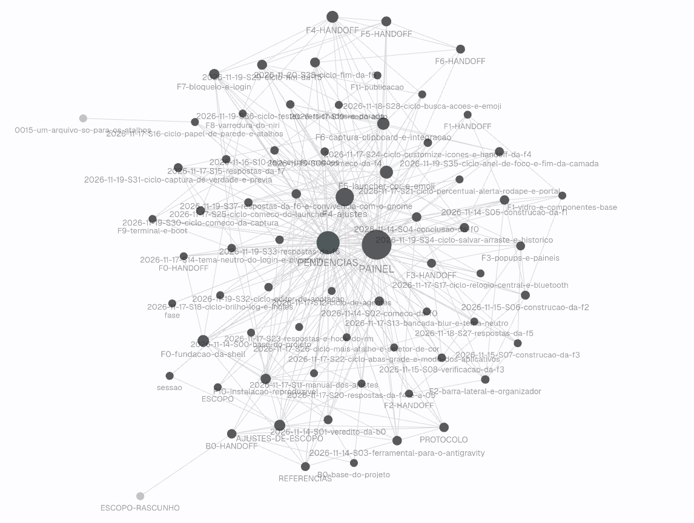
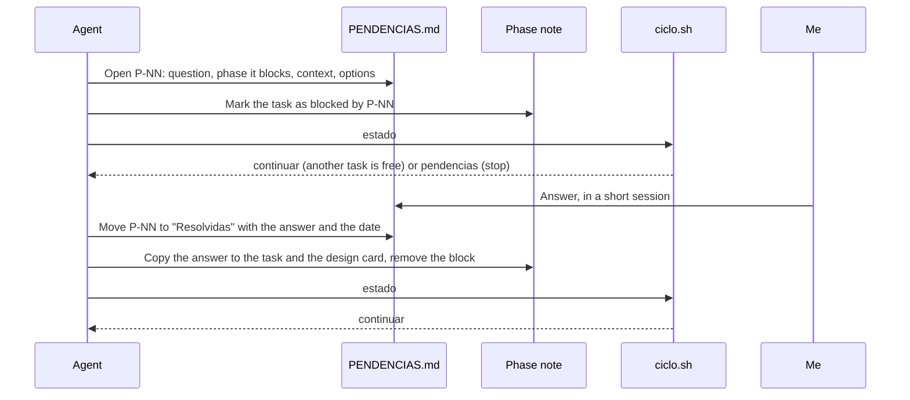

# The project panel in Obsidian

The panel is where the project's state lives: what I asked for, which phase is active, what each session did, what is waiting for an answer from me. It is a folder of plain Markdown notes inside my Obsidian vault, at `~/Documents/Journal/projeto-dotfiles/`, and it is not part of this repository.

This page describes how it is organised and how agents and I used it. The overview of the whole workflow is in [README.md](README.md).

*The panel in Obsidian's graph view: each dot is a note, each line a link between two notes. The folder held 69 notes when I paused the project. The two largest nodes are `PAINEL` (the entry point) and `PENDENCIAS` (the pending questions), which almost every session report and phase note links to. The ring around them is made of the 39 session reports, the 13 phase notes and the 8 handoffs. The two pale dots at the edge are links to notes that do not exist in the vault: a decision record that lives in the repository, and the scope draft that became `ESCOPO.md` when I approved it.*

## Why it lives outside the repository

The decision is recorded in [`docs/decisoes/0004`](../decisoes/0004-painel-no-obsidian.md). In short:

- **I already look there.** I use Obsidian as a journal, so the panel sits where I naturally check things.
- **It is plain Markdown.** Any coding agent reads and writes it without an extra tool, and I can read it without opening the repository.
- **It is process, not product.** Someone who clones these dotfiles wants the shell and the configuration, not the log of my work sessions. The decisions, which explain why the product is the way it is, stay in the repository under [`docs/decisoes/`](../decisoes/README.md).

The cost is real and I accepted it knowingly: the panel has no version control. Its protection is the vault's own sync and backup. That is why exactly one session writes to it at a time, and why in the agent cycle only the orchestrator does.

For anyone who clones the repository the panel path does not exist, and the tooling that depends on it does nothing: the session-start hook exits silently when it finds no panel. The path can be changed with the `DOTFILES_PAINEL` environment variable.

## What is in it

| Note or folder | Role | Who writes |
|---|---|---|
| `PAINEL.md` | Entry point: state of every phase, what is happening now, the next step, a one-line registry of every session | The agent, at the end of each session |
| `ESCOPO.md` | The scope. Immutable since I approved it on 2026-11-14 | Nobody |
| `AJUSTES-DE-ESCOPO.md` | Scope adjustments (`A-01`, `A-02`, ...). Append-only: old entries are never rewritten | The agent, when I change what I want |
| `PENDENCIAS.md` | Pending questions (`P-01`, `P-02`, ...) that only I can answer, each with the phase it blocks | The agent opens them; the answer is mine |
| `PROTOCOLO.md` | How the panel itself is maintained | Written once, updated when the method changed |
| `REFERENCIAS.md` | The study material and what did not come in the design package | Written once |
| `fases/` | One note per phase: goal, inputs, tasks, acceptance criteria, subphases, verdict | The agent, as each task ends |
| `sessoes/` | One report per work session, `YYYY-MM-DD-SNN-subject.md` | The agent, as the last thing in a session |
| `handoffs/` | One handoff per phase, with the test script and the verdict; `FN-prints/` folders hold the approved prints | The agent prepares; my words are recorded in it |
| `modelos/` | Templates for a phase note, a session report and a handoff | Written once |
| `anexos/` | Loose material a pending question needed to keep | The agent |

Everything is written in first person, as in the repository. Notes link to each other with Obsidian wiki links, which is what produces the graph above.

### Identifiers

| Kind | Format | Example |
|---|---|---|
| Phase | `B0`, `F0` to `F11` | `F2` |
| Subphase | phase, dot, number | `F2.1` |
| Task | phase or subphase, `-T`, number | `F6-T08` |
| Session | `S` and two digits | `S35` |
| Pending question | `P-` and a number | `P-88` |
| Scope adjustment | `A-` and a number | `A-03` |

An identifier is never reused. A cancelled task stays in the note, struck through, with the reason. These identifiers are what tie the panel to the repository: commit hashes are cited in the phase notes, and task and question identifiers appear in code comments, design cards and decisions.

### Where each thing is written

The rule is that nothing stays only in the conversation. Whatever comes up has a place, and it is written when it comes up, not at the end.

| It came up during a session | It goes to |
|---|---|
| A task finished, or a new one appeared | The phase note |
| An adjustment inside a phase | A subphase in the phase note |
| A question I need to answer | `PENDENCIAS.md` |
| A change in what I want | `AJUSTES-DE-ESCOPO.md` |
| A lasting technical decision | `docs/decisoes/` in the repository |
| What happened in the session | A report in `sessoes/` |
| A phase ready for me to evaluate | A handoff in `handoffs/` |
| The overall state and the next step | `PAINEL.md` |

## Scope: one document that never changes

`ESCOPO.md` says what I wanted at the start. After I approved it, it became read-only in three ways: the file is read-only on disk, Claude Code has a deny rule for it in [`.claude/settings.json`](../../.claude/settings.json), and Antigravity has a protection hook ([`.agents/hooks/antigravity-protecao.py`](../../.agents/hooks/antigravity-protecao.py)).

When something had to change, the agent wrote a new entry at the end of `AJUSTES-DE-ESCOPO.md` with the date, the session, what changes, the reason (in my words when I gave one), how it relates to the scope, and the impact on phases and tasks. In case of conflict, the scope plus the adjustments, oldest to newest, is what holds.

There are eight adjustments. They are the honest history of how the plan moved: the batch live QA and the agent cycle (`A-03`), the rule for pieces without a Figma board (`A-05`), and the last one, the pause (`A-08`). With this split I can always answer two separate questions: what did I want at the beginning, and what changed along the way.

## The session protocol

Every session, in either tool, follows the same three steps. They are packaged as project skills so that the protocol does not depend on the agent remembering it.

### Opening (`/retomar`)

1. Read `PAINEL.md`. A session-start hook ([`estado-do-projeto.sh`](../../.agents/hooks/estado-do-projeto.sh)) already injects it into the agent's context, so the session begins knowing the active phase and the next step.
2. Read the active phase note and the latest session report.
3. Read `PENDENCIAS.md` and separate what blocks the active phase.
4. Check `git status` and `git log`.
5. Check consistency. If there is a commit newer than the last session report, the previous session ended without recording what it did, and the first job is to reconstruct it from git. The hook makes this comparison by itself and prints a warning.

The skill ends in a short summary whose last line is always "what I do now", with the literal thing to type. The first time I used it, it described the state correctly and I still did not know what to type next, so that last line became a rule.

### During the session

- One phase at a time, in the order of the panel. No task from a future phase is done early.
- Each task is marked in the phase note at the moment it ends. A finished task line says what was done, the commits, what was measured, where the prints are and what is left to see live.
- Anything outside the plan goes to the panel on the spot: a subphase, a pending question or a scope adjustment.

### Closing (`/encerrar-sessao`)

In this order: decisions, commit, session report, phase note, pending questions, scope adjustments, `PAINEL.md`, and a final re-read of the panel as if for the first time.

The commit comes before the report on purpose, because the session-start hook treats a commit newer than the last report as an unrecorded session. The report template has fixed sections (where I started, what I did, what was left halfway, decisions, problems and discoveries, questions opened, scope adjustments, files changed, where I stopped, next step), and an empty section is written as "Nothing" instead of being deleted.

Two rules make this hold under pressure:

- A session is only closed when the panel describes the real state.
- If the context is running out, closing has priority over finishing the task. A half-done task recorded precisely is worth more than a finished one that is not recorded.

In the agent cycle, each block of up to four tasks closes with exactly this procedure, so a cycle block is an ordinary session report.

## How a pending question flows

The rule "never invent a value" needs somewhere for the missing value to go. That place is `PENDENCIAS.md`.

A question is written so that I can answer without rereading the conversation: what the sources say, why they disagree, the options, and what each option costs. Many of them do not block anything; they record a choice the agent made under adjustment A-05 and that I confirm later from the print.

A real example, `P-88`:

1. While measuring the desktop boards for task `F6-T07`, the orchestrator found that the numbers I had given in an earlier answer (`P-18`: a sidebar zone of 168 and 60) did not reproduce my own Figma board (176 and 68).
2. My answer ranks above Figma in the order of trust, but the answer itself said "as in Figma". Instead of picking, the agent opened `P-88` with both sets of numbers and marked `F6-T07` and `F6-T09` as blocked.
3. The cycle went on with the tasks that did not depend on it, then stopped with `pendencias` when only blocked tasks were left.
4. I answered in the next session (option A: Figma). The answer went to the "resolved" table, to the phase note and to the design card.
5. The following block of the cycle finished both tasks.

Of the 90 questions opened in the week, 78 were resolved and 12 remain open; the open ones belong to phases that never started, or are non-blocking questions about compositions and details I had not judged yet.

## Handoffs and live QA

A phase ends in `aguardando QA`, never in `go`. The `/qa-fase` skill has four modes around that gate.

| Mode | When | What it does |
|---|---|---|
| `preparar` | All tasks of the phase are done | Checks each acceptance criterion with evidence, writes the handoff, moves the phase to `aguardando QA` |
| `ao-vivo` | I open the agent inside the Niri session | Applies the "apply in the live session" list with my ok, item by item, then walks me through the script one step at a time and writes down what I say |
| `go` | I approve | Records the verdict with the date and my words, unsummarised; observations become tasks or questions |
| `no-go` | I reject | Records the verdict, opens a subphase with one task per problem as I described it |

A handoff has fixed sections:

- **What the phase delivered** and **how to open it**.
- **Apply in the live session**: what was prepared in the repository and can only go to the system with me present (key bindings in the Niri configuration, permissions, packages), with the command and what it changes. The agents never write to `~/.config/` by themselves.
- **Test script**: a numbered table of actions I perform, each with the expected result. Written for someone who tests without reading code: "press the shortcut and the sidebar collapses", not "check `collapseWidth`".
- **Acceptance criteria checked**, each with its evidence, or marked "verify live".
- **What was not verified** and **known limitations**, with nothing left out.
- **Verdict**, and one new section per later QA round. Earlier rounds are not erased.

During the live session the script table gains a fourth column filled in as we go: seen or not passed, the date, my words in quotes, what the agent checked on the spot, and any correction applied with my explicit ok. When the agent's own evidence disagreed with my answer, it wrote that down as a reservation next to it. The F4, F5 and F6 handoffs are therefore also the record of what happened on 2026-11-20; the summary is in [lessons.md](lessons.md).

## What the panel is not

- **Not the agent's memory.** Claude Code's automatic memory and Antigravity's knowledge store are explicitly not the project record. What must survive between sessions goes to the panel, where I can read it.
- **Not a second task board.** Skills and tools that create their own task lists are listed as "do not use here" in [`.agents/SKILLS.md`](../../.agents/SKILLS.md). A second board is exactly the kind of duplication that makes things get lost.
- **Not versioned.** I cannot diff yesterday's panel against today's. The session reports are the history, and the one-writer rule is the lock.
