# Wintermute Shell: component catalogue

Wintermute Shell is the desktop shell I built for the Niri compositor, written in Quickshell/QML: a sidebar, panels, a settings screen, a launcher with its tools, and a screen capture flow. The visual system is called Armitage. The shell is always dark, built from glass surfaces, and comes in three variations that change only the accent colour: **Chiba** (blue, `#52C2F6`), **Freeside** (violet, `#7F89E1`) and **Sprawl** (amber, `#F4A846`). Neutrals and layout are identical in all three.

This folder shows each piece with a picture, what it does, and how far I got validating it.

## Reading the pictures

- Every image here comes from my screenshot bench, which renders a piece in a plain window with fictitious data. **The bench has no compositor blur, so the glass looks more opaque here than it does on Niri**, where the wallpaper and windows show through it.
- All names, networks, addresses, files and hardware in the pictures are invented. A few demo strings are in Portuguese.
- The pieces are shown on the shell's dark background colour, not on a wallpaper.
- Measures and behaviour quoted on these pages come from the design cards in [`docs/design/pecas/`](../design/pecas/) (in Portuguese), which are the source of truth.

## Live on Niri

These are real screenshots of the running shell on Niri, taken on an empty workspace with the sidebar's demo cards switched on. Here the glass does blur what is behind it.

| | |
|---|---|
| 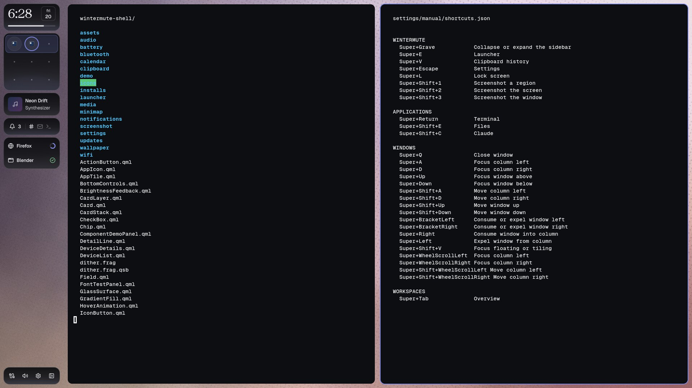 | 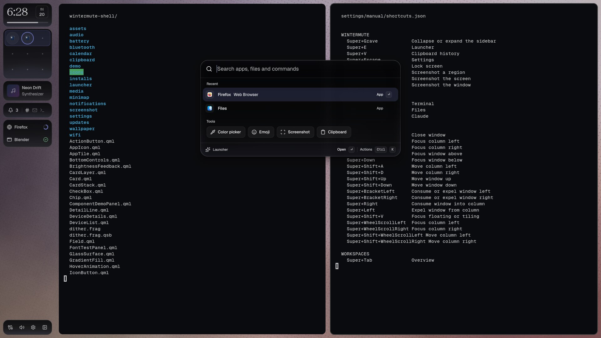 |
| 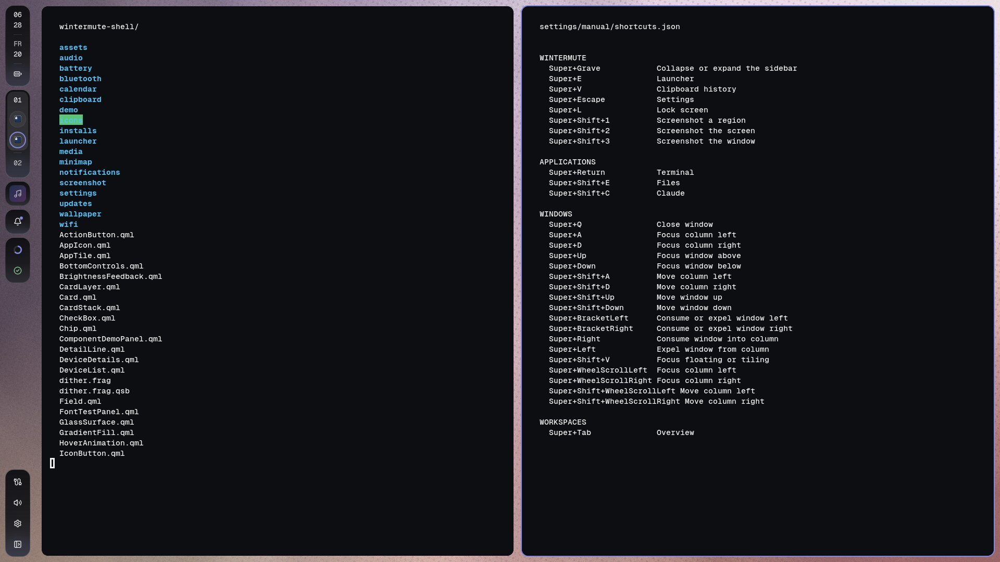 | 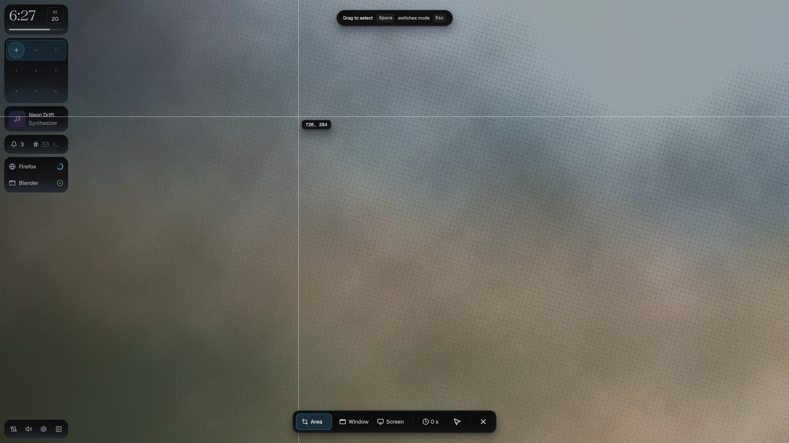 |
| 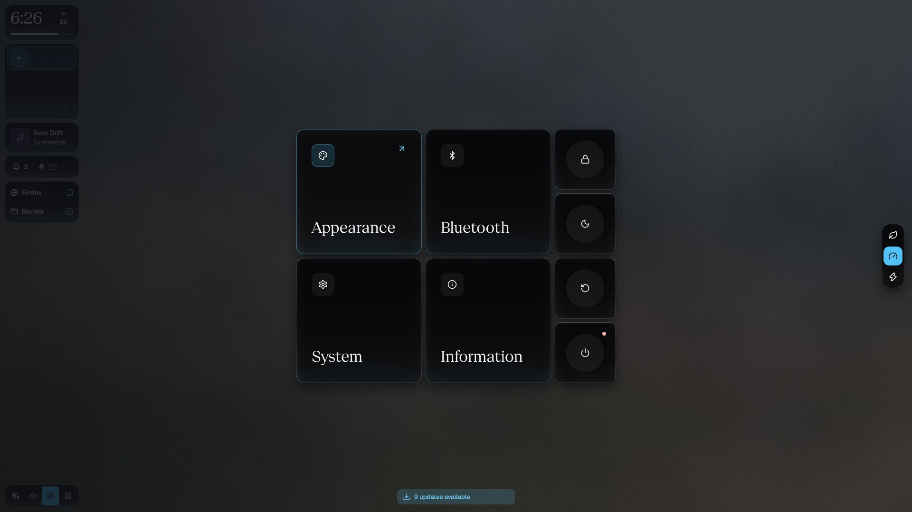 | 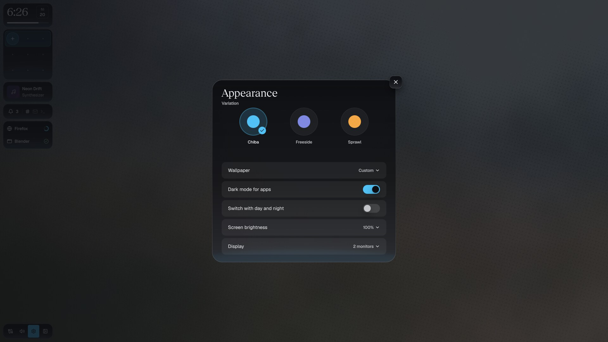 |
| 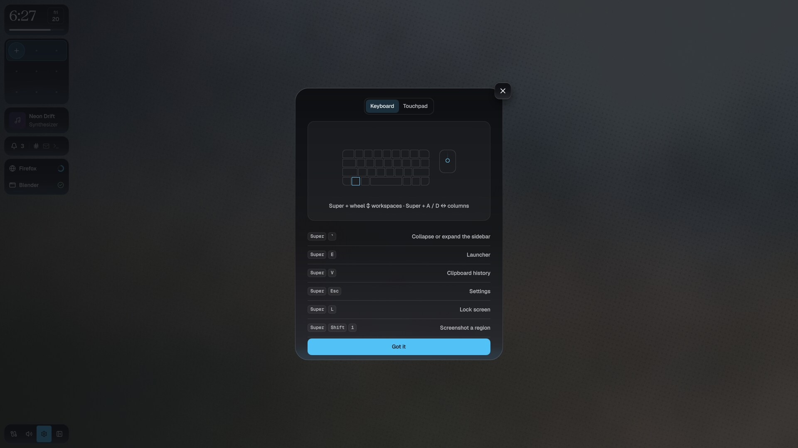 | 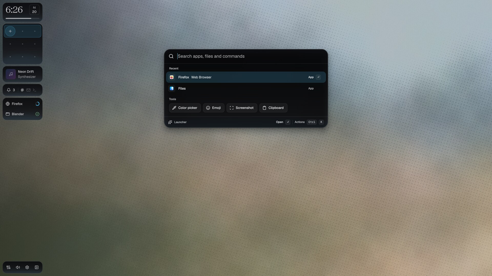 |

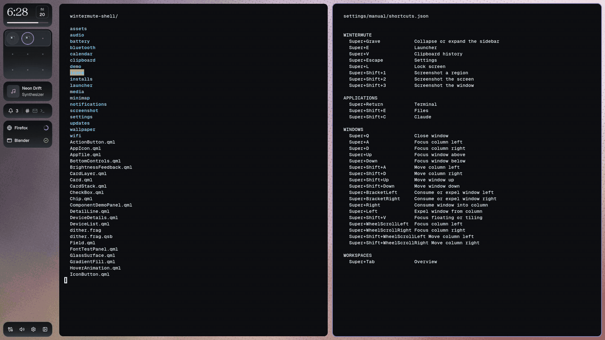

This is a real screen recording, about 40 seconds, also available as [tour.mp4](assets/live/tour.mp4). I drove the shell over IPC while recording, so it shows what opens by command: there are no clicks or hover states in it, and the panels that only open with a click (Wi-Fi, sound, Bluetooth, calendar, notification centre) are not in it.

## Status

The project is paused. I validated the shell phase by phase in a live Niri session:

| Area | Phase | Live QA on Niri |
|---|---|---|
| Glass and base components | F1 | Passed |
| Sidebar and workspace organizer | F2 | Passed |
| Panels, pop-ups and OSDs | F3 | Passed |
| Settings | F4 | Passed |
| Launcher, colour picker and emoji picker | F5 | Passed |
| Screen capture, clipboard history and Niri integration | F6 | **Not finished** |

What is open in F6: the capture window and the colour-picker loupe can crash Quickshell when I use them with a real pointer on two monitors (the shell restarts by itself, and I have not found the cause), and the capture's Window mode cannot highlight tiled windows, because the Niri IPC returned no position for them. Most of the F6 checklist was never run live. Each page says what was seen and what was not.

The lock screen and login screen (F7) were never built, so the "Lock" and "Sleep" entries have no effect yet.

## The three variations

The same desktop composition, sidebar open, in each variation. The focus ring, the selected states and the soft glow at the base of each card follow the accent; nothing else changes.

| Chiba | Freeside | Sprawl |
|---|---|---|
| 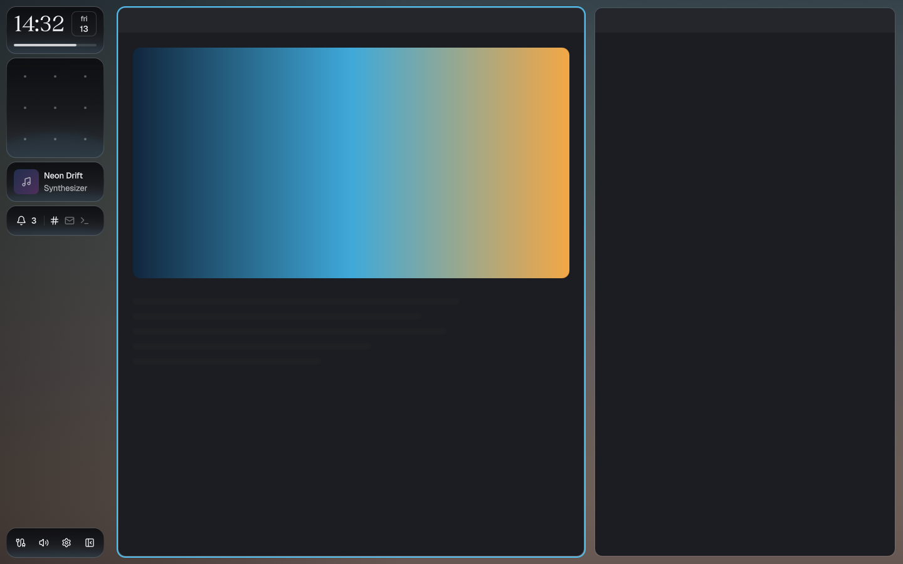 |  |  |

These are bench compositions: the sidebar cards are the real pieces, the two windows and the focus ring are sample shapes. See [Desktop](desktop.md).

## Contents

| | Page | What is in it |
|---|---|---|
| 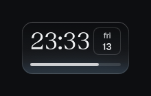 | [Sidebar](sidebar.md) | The sidebar, clock, workspace organizer, media card, notifications card, bottom controls and OSDs |
| 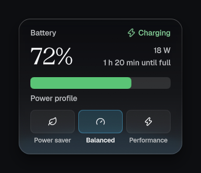 | [Panels](panels.md) | Wi-Fi, Bluetooth, sound, battery, calendar, notification centre and toasts, appearance |
| 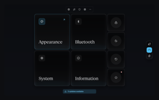 | [Settings](settings.md) | Home, system pages, display and arrange, information, manual, wallpaper picker and Customize, dropdown menu |
| 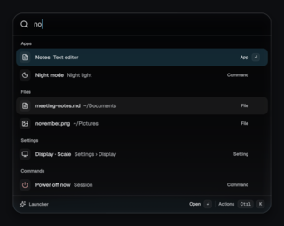 | [Launcher](launcher.md) | Search, grouped results, calculator, actions menu, colour picker and loupe, emoji picker, clipboard history |
| 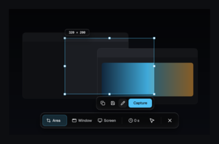 | [Capture](capture.md) | Capture window and modes, area selection, annotation editor, save toast, preview in the sidebar |
|  | [Desktop](desktop.md) | The four full-desktop compositions and what the shell needs from Niri |

## Design rules behind every piece

- Titles in Geist Serif, body in Geist, numbers in Geist Mono. Interface icons are Lucide.
- A 4 px grid, with no fractional positions.
- The pure accent appears only in fills and details; coloured text uses a lighter accent tone, and text on top of the accent is near-black.
- No value is invented: every colour, measure, radius and duration comes from the tokens and the design cards.

The shell's code starts from a copy of the Pond shell interface (BSD-3-Clause) and was redesigned piece by piece. How to run it and where each part lives is in [`wintermute-shell/README.md`](../../wintermute-shell/README.md).
