# Capture

[Back to the index](README.md)

Screen capture with a capture window, an annotation editor, a save toast and a preview in the sidebar. The capture window and the editor are pieces I designed from scratch.

This is phase F6, and **its live QA on Niri was not finished**. What was seen live and what was not is at the [end of this page](#status); read it before trusting any picture here as working software.

**Super+Shift+1** opens the capture window, and so does the "Screenshot" chip of the [launcher](launcher.md). Super+Shift+2 (screen) and Super+Shift+3 (window) stay with Niri's own instant screenshots, which then show up in the sidebar preview.

## Capture window and modes

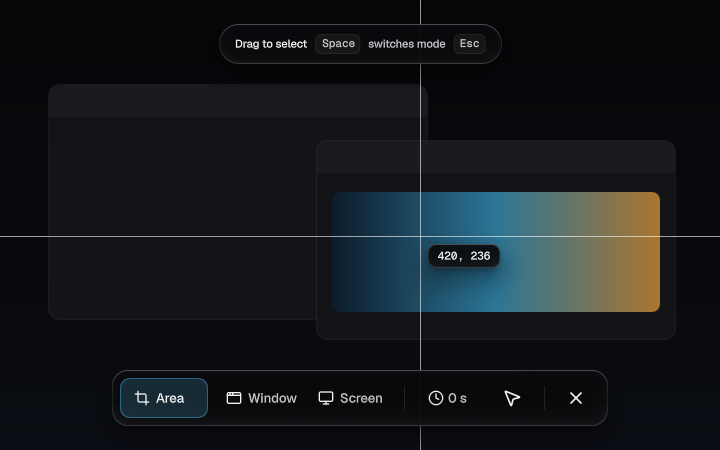

Opening the capture freezes every monitor and dims it. On the monitor under the pointer, a crosshair with a coordinates pill replaces the pointer, a hint sits at the top and the mode bar at the bottom: Area, Window, Screen, a "0 s" delay indicator, a button to include the mouse cursor in the image, and close.

**Space** cycles through the modes and **Esc** always closes. The capture always starts from zero: Area mode, cursor off, no selection, and nothing is remembered between one opening and the next. The delay indicator is drawn but does not respond; there is no delay selector.

## Area selection

| Chiba | Freeside | Sprawl |
|---|---|---|
| 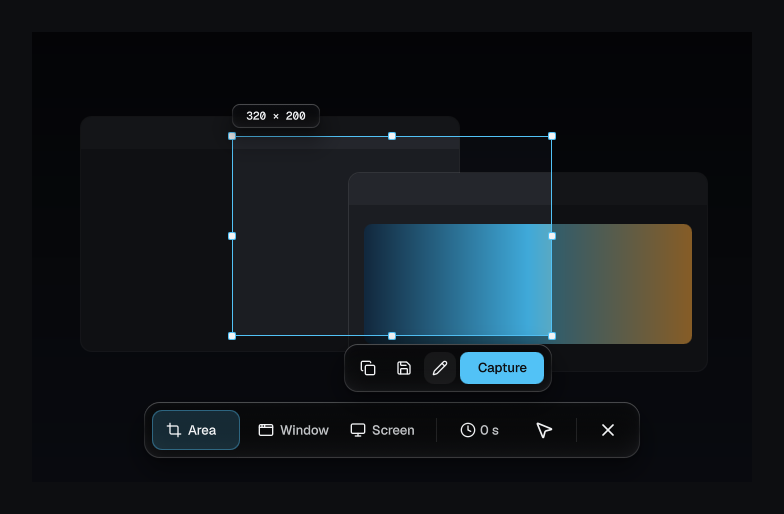 | 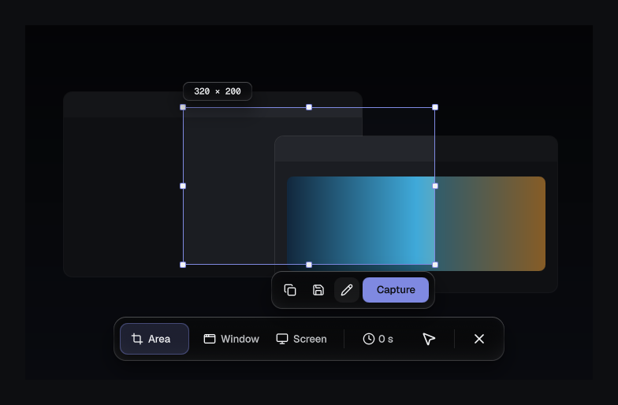 | 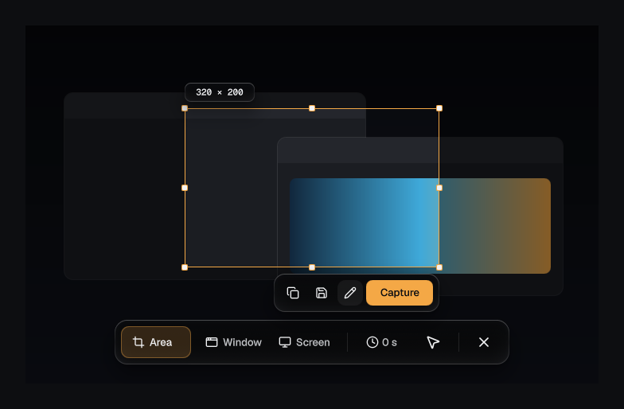 |

Dragging creates a selection: the outside darkens further, the inside shows the clean image, with a 1 px accent border and eight handles. A pill above shows the size in monitor pixels, and a pill below holds the actions: copy, save, annotate and "Capture". Dragging inside moves the selection, the handles resize it, and pressing outside starts a new one. Near the screen edges the pills move so they never leave the monitor.

**Enter** is the same as "Capture": it writes the image, copies it to the clipboard, hands it to the sidebar preview and closes. The copy button copies and closes without the preview.

## Window and Screen modes

| Window | Screen |
|---|---|
| 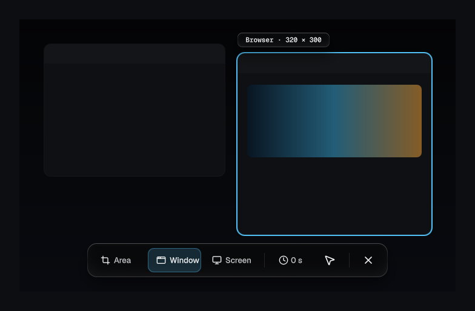 | 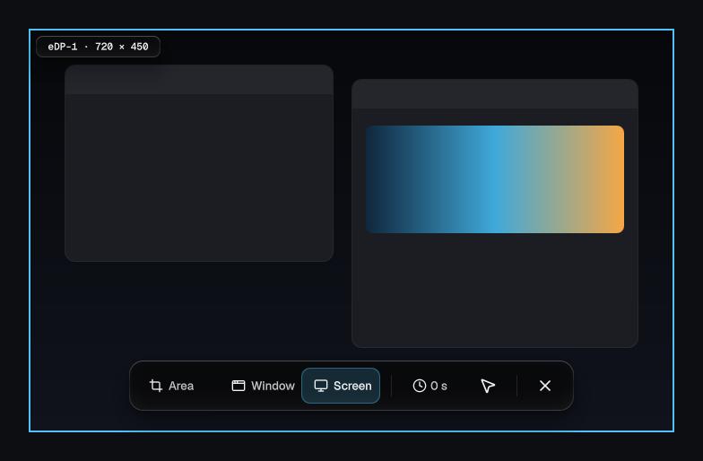 |

In Window mode the whole screen is dimmed and the window under the pointer gets a 2 px accent ring and a pill with the app name and the window size; a click or Enter captures only that window. In Screen mode the monitor under the pointer is left undimmed, with the ring inside its edge and a pill with the monitor's name and size; a click or Enter captures the whole monitor. Screen mode has no design board; I composed it with the same values as Window mode.

Window mode depends on the position Niri reports for each window. On my machine the Niri IPC returned no position for tiled windows, so **Window mode cannot highlight tiled windows**. The picture above is a bench scene with sample windows.

## Annotation editor

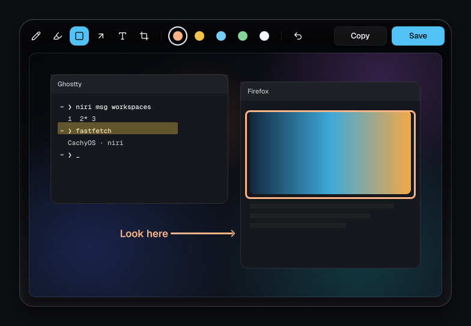

The pencil button, in the actions pill or in the sidebar preview, opens the image in a small editor. Six tools: pencil, highlighter, rectangle, arrow, text and crop. Five colours, and undo with the button or **Ctrl+Z**. "Copy" copies the image with the marks and sends it to the sidebar preview; "Save" writes it to the screenshots folder. Esc closes and discards the marks (when no text or crop is in progress, where it cancels that first); a click outside does not close, so a stray click cannot throw the drawing away.

Not in this version: moving, resizing or deleting an existing mark, redo, and choosing thickness or font.

## Save toast

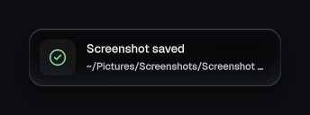

Saving exists in three places: the actions pill, the sidebar preview and the editor. It writes a PNG to `~/Pictures/Screenshots`, with the same file name pattern Niri uses, so the shell's captures and Niri's stay together and in order. A toast with the path appears at the bottom, next to the sidebar, for three seconds.

## Preview in the sidebar

| At rest | Hover | Sidebar collapsed |
|---|---|---|
| 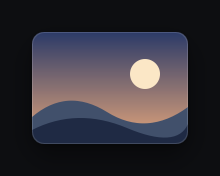 | 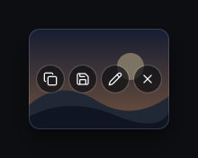 | 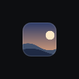 |

After a capture, a thumbnail appears above the bottom controls of the [sidebar](sidebar.md) and disappears after six seconds; the timer stops while the pointer is over it. Hovering shows four buttons: copy, save, annotate and close. With the sidebar collapsed the thumbnail is a 48 px square with a single copy button on hover.

Dragging the thumbnail into another app uses a small optional C++ plugin that has to be compiled once. Without it the shell works the same, minus the drag.

## Status

**Live QA on Niri not finished (F6).**

Seen live, on two monitors at scale 1:

- Opening the capture, switching modes with Space and with the mode bar, the cursor button, Esc, and opening from the launcher chip without the launcher appearing in the frozen image.
- The capture and the settings screen closing each other.
- Area selection: creating, moving, resizing, the pills near the screen edges.
- "Capture" and the copy button: the pasted image was the selected area, and the preview appeared in the sidebar.
- Reopening the capture with no leftover selection. I marked it as passed, but the session log did not show two openings in a row, so this one, which is an acceptance criterion of the phase, still needs a clean re-check.

Found live:

- At first the capture window froze the screen but drew nothing on top. The piece was being drawn underneath the frozen frame; I fixed the stacking order during the QA.
- **Quickshell crashed four times while I used the capture with a real pointer on two monitors** (six that day, counting the two with the colour loupe), with a segmentation fault inside Qt. The shell restarted by itself every time but the last. Ten deliberate rounds of opening and closing the capture through IPC did not reproduce it, a workaround that delays the window hide did not hold, and the cause is open. Picking a colour with the [loupe](launcher.md#colour-picker), which uses the same kind of window, crashed the same way.
- The Niri IPC returned no position for tiled windows, which Window mode needs.
- I opened the annotation editor once and it worked, and a crash followed shortly after.

Not seen live:

- Window mode and Screen mode, and the capture on a monitor with a scale other than 1.
- The annotation editor's tools, crop, undo, Copy and Save, step by step.
- Saving from the three places, and the save toast.
- The preview's buttons, its six-second timer, the collapsed preview, and dragging it into another app.
