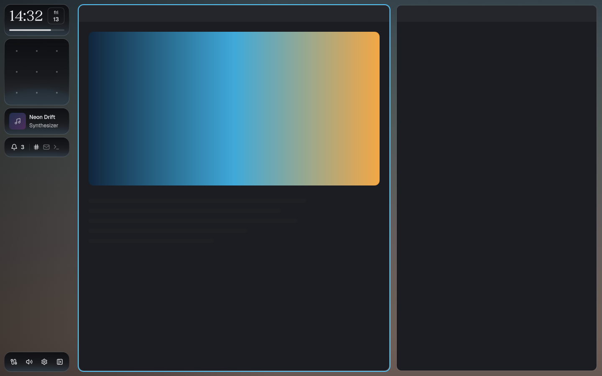
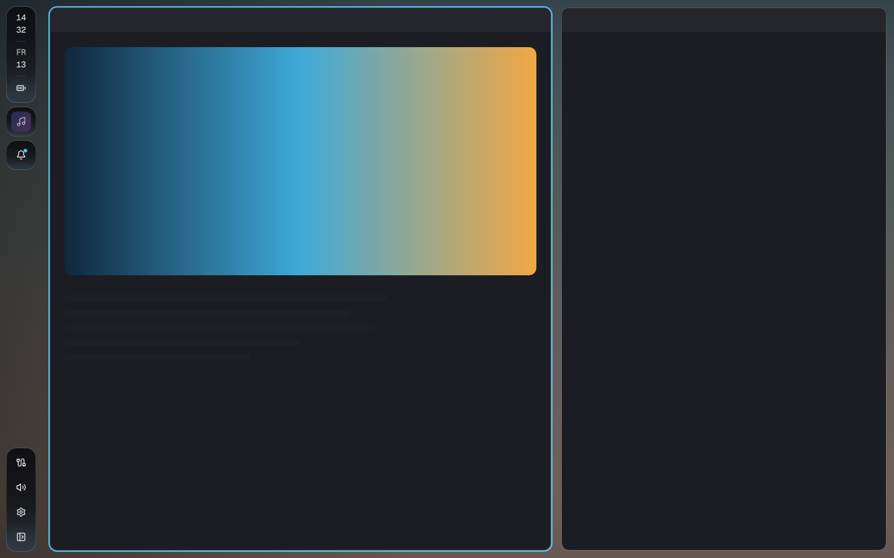
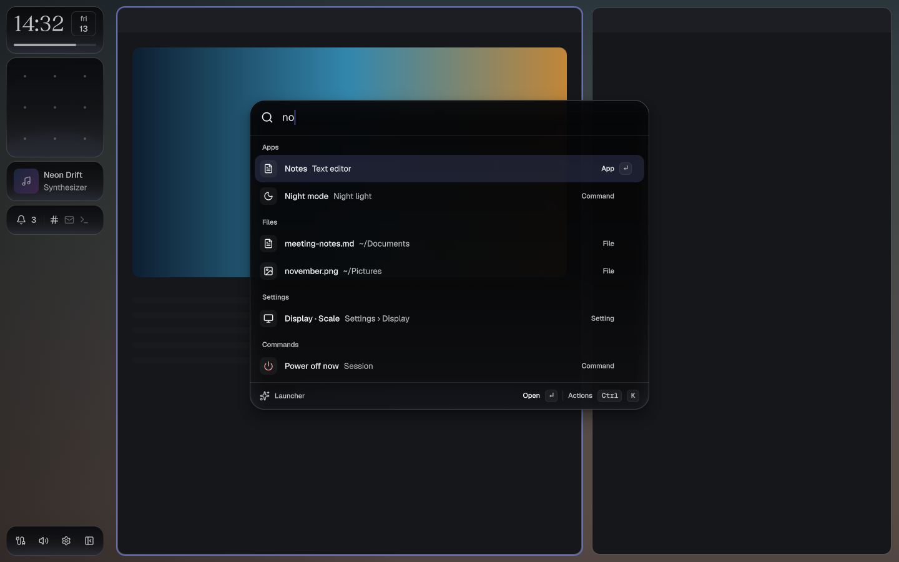
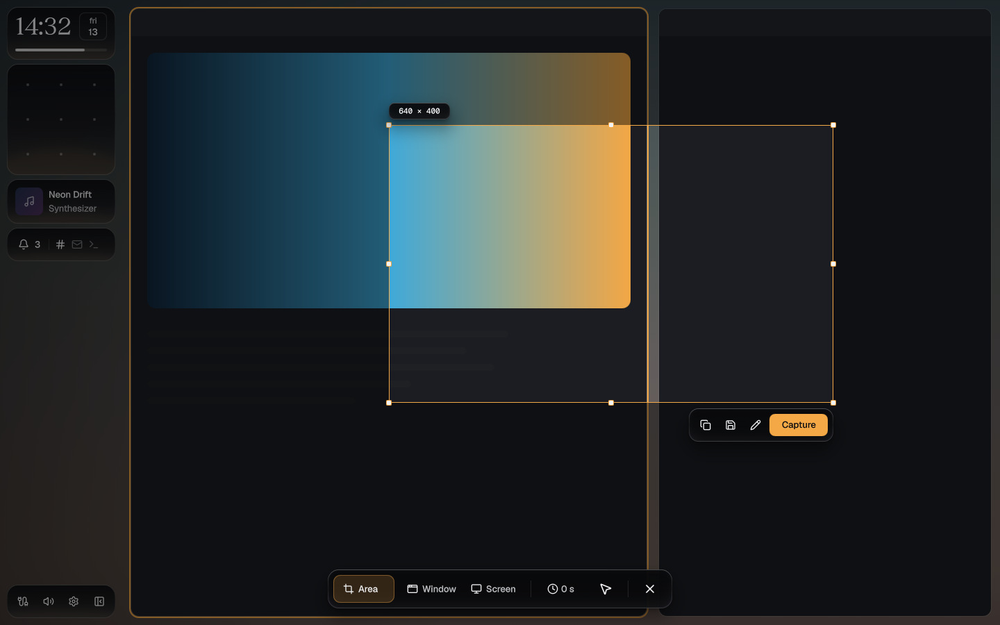

# Desktop

[Back to the index](README.md)

The pieces of the other pages assembled on a 1440 × 900 desktop, in the four states I use as the final acceptance of phase F6, and what the shell needs from Niri for the real desktop to match them.

## About these pictures

The real desktop only exists inside a Niri session: the windows, the space reserved for the sidebar and the focus ring belong to the compositor. These pictures come from a bench composition that mounts the real pieces on a stage of the same size.

- **Real pieces:** the wallpaper with its veil, the sidebar cards, the launcher and the capture.
- **Sample shapes:** the two windows, the focus ring and the capture's selection.
- The wallpaper is the shell's dynamic sky fixed at one moment of the day, not the one from my design board. On Niri it is whatever wallpaper I choose.
- The workspace organizer reads Niri, so outside it the card is empty (sidebar open) or absent (sidebar collapsed).
- The launcher's glass comes out much darker here than on my design board. The bench has no compositor blur, which is what lightens the glass with whatever is behind it.

## The four states

### 1. Sidebar open

| Chiba | Freeside | Sprawl |
|---|---|---|
|  |  |  |

The sidebar cards sit 10 px from the left, top and bottom edges. The first window starts at x 188. The focused window has a 2 px ring in the accent and the windows have a 12 px corner radius; the next column may run off the screen, as Niri does. Behind the sidebar, the wallpaper layer draws a black veil that fades from 40% to nothing, for contrast.

### 2. Sidebar collapsed



Collapsing the sidebar (the corner button or **Super+`**) gives 108 px back to the windows: the first window now starts at x 80. The shell only changes the space it reserves; the sliding of the windows is Niri's.

### 3. Launcher open



The [launcher](launcher.md) opens centred horizontally, with its top at 160/900 of the screen height, over a 20% black veil.

### 4. Capture in progress



The [capture](capture.md) with an area selected: the outside is dimmed 45%, sidebar included, with the size pill above the selection, the actions pill below it and the mode bar at the bottom.

## What the shell needs from Niri

Three things on the Niri side make the real desktop come out like the pictures.

| What | Value | Where it comes from |
|---|---|---|
| Space reserved for the sidebar, open | 176 px | 10 + 156 + 10: margin, card, margin. The shell reserves it. |
| Space reserved for the sidebar, collapsed | 68 px | 10 + 48 + 10 |
| Between two columns | 16 px | `gaps 16` in my Niri layout |
| At the screen edges and next to the sidebar | 12 px | `struts` of −4 on the four sides: 16 − 4 |
| First window, sidebar open / collapsed | x 188 / x 80 | 176 − 4 + 16 and 68 − 4 + 16 |
| Focus ring | 2 px, in the accent of the variation | `focus-ring` in Niri |
| Window corner radius | 12 px | a Niri window rule |

Niri has a single `gaps` value, used both between columns and at the edges. To get 16 between columns and 12 at the edges, I keep `gaps 16` and take the difference away from the edges with negative `struts`. One depends on the other: if I change `gaps`, the edge becomes `gaps − 4`.

The shell writes the focus ring, the struts and the corner radius to a file of its own in the Niri configuration folder, `cfg/wintermute.kdl`, once at start-up and again every time the variation changes, so the ring follows the accent:

```kdl
layout {
    focus-ring {
        width 2
        active-color "#52C2F6"
    }
    struts {
        left -4
        right -4
        top -4
        bottom -4
    }
}
window-rule {
    geometry-corner-radius 12
    clip-to-geometry true
}
```

The file is marked as generated, and the script refuses to write over a file that does not carry its marker. It only takes effect with one line that I add by hand at the end of Niri's `config.kdl`:

```kdl
include "./cfg/wintermute.kdl"
```

The shell never edits any other file of the Niri configuration. Removing the `include` undoes everything.

## Known differences from the design board

- The focus ring is drawn outside the window, which is how Niri's `focus-ring` works; my board draws it inside the window frame.
- The capture's mode bar sits 24 px from the bottom, as in the capture board; the desktop board puts it at 32 px.

Both are open decisions.

## Status

**Not finished (F6).** The four desktops with real windows are the acceptance criterion of the phase, and I never assembled and compared them on Niri.

Seen live:

- With the `include` in place, the negative struts took effect: a single window on a 1920 × 1080 monitor was 1056 px tall, which is 1080 − 24.
- When I changed the variation in the settings, the shell rewrote its file with the new accent.

Not seen live:

- The measurements with two columns: x 188 and x 80, 12 at the edges, 16 between columns.
- My own confirmation, on screen, of the ring changing colour and of the 12 px radius.
- A fullscreen and a maximized window, and the focus ring of the monitor that does not have focus.
