# Launcher

[Back to the index](README.md)

The launcher is a piece I designed from scratch: one 640 px glass window that searches apps, files, settings and session commands, does arithmetic, and hosts three tools as sub-pages (colour picker, emoji picker and clipboard history). **Super+E** opens it on the focused monitor; Esc or a click outside closes it.

The launcher, the colour picker and the emoji picker are phase F5, which passed my live QA on Niri. The clipboard history is phase F6 and was not validated live.

## Empty state and tools

| Opened by the shortcut | Opened by the "+" of a workspace |
|---|---|
| 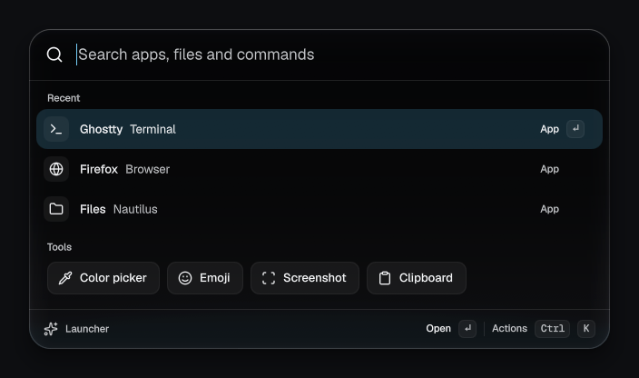 | 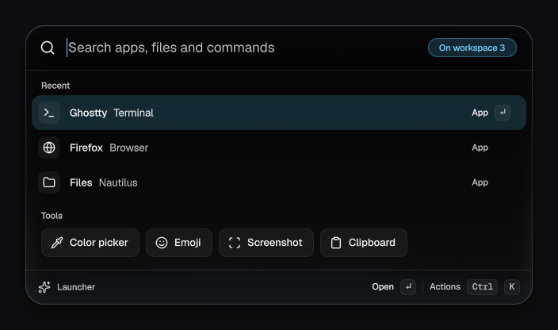 |

With an empty search, the launcher shows the last apps I opened through it and four tool chips. Down goes from the list into the chips, Left and Right move between them, Enter opens the tool.

When it is opened by the "+" of a row in the [workspace organizer](sidebar.md#workspace-organizer), a tag in the header says which workspace it is, and the app I pick is born there.

**Status:** passed live QA on Niri (F5).

## Search and grouped results

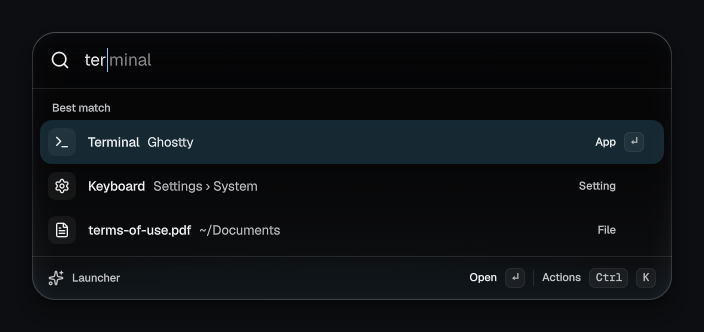

Results update on every key. Matching ignores case and accents and looks for a continuous piece of text, with no fuzzy search; a prefix of the title ranks first. When the text is the start of the first result's title, the rest appears as a ghost suggestion and **Tab** accepts it. With up to three results, they come in a single "Best match" section.

| Chiba | Freeside | Sprawl |
|---|---|---|
| 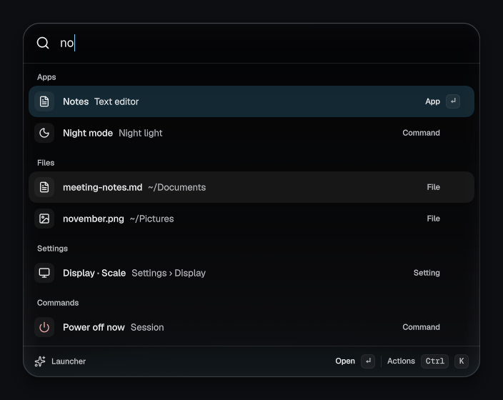 | 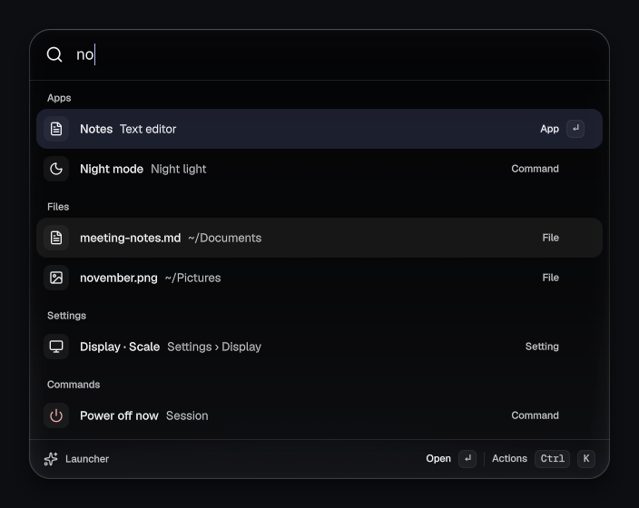 | 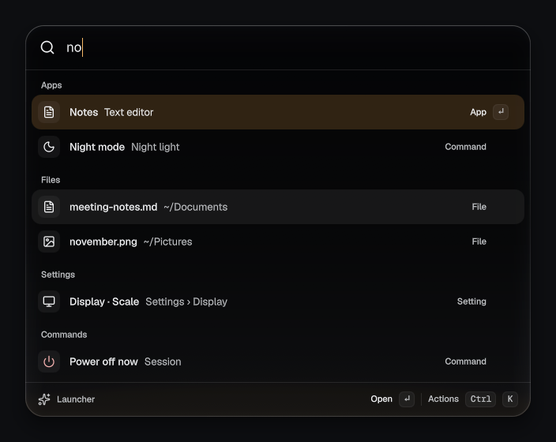 |

With four or more results they are grouped in a fixed order, Apps, Files, Settings, Commands, with up to five rows each. Up and Down move the selection, Enter opens. The sources are:

- **Apps:** the desktop entries that show up in menus.
- **Files:** a search by name with `fd` in the standard user folders, from two characters on. Without `fd` installed the group does not appear.
- **Settings:** the settings pages, opened directly.
- **Commands:** Lock screen, Sleep, Restart, Power off and Log out. Restart, Power off and Log out have a danger-coloured icon and ask for a second Enter to confirm.

The rows in these pictures are bench demo data, not the real lists.

**Status:** passed live QA on Niri (F5). "Lock screen" and "Sleep" had no effect in live QA, because the lock screen was never built.

## Calculator

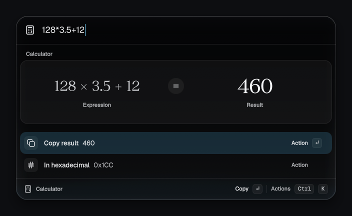

When the whole text is an expression with at least one operation, the launcher becomes a calculator. It accepts `+`, `-`, `*`, `/` and parentheses, with comma or point as the decimal separator, and the expression is parsed by my own code, never evaluated as code. **Enter** copies the result and closes; a second row offers the hexadecimal form when the result is a non-negative integer.

**Status:** passed live QA on Niri (F5).

## Actions menu

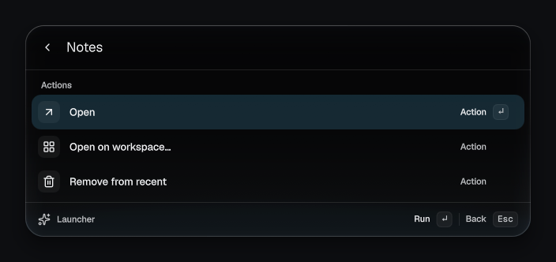

**Ctrl+K** opens the actions of the selected row as a sub-page: for an app, open, open on a chosen workspace, or remove from the recent list; for a file, open, show in folder or copy the path; for a calculation, copy the result or its hexadecimal form. Esc or Backspace go back one step.

**Status:** passed live QA on Niri (F5).

## No result

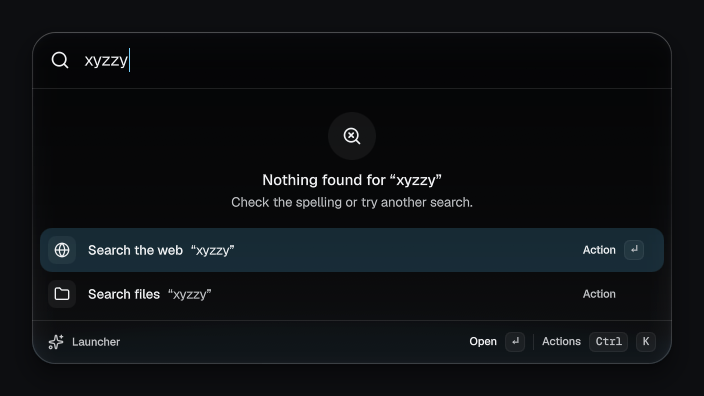

When nothing matches, the launcher offers two actions. "Search the web" opens the default browser with the search. "Search files" repeats the file search inside the launcher across the whole home folder, including hidden folders, and shows the results in a single Files section.

**Status:** passed live QA on Niri (F5).

## Colour picker

| Result page | Loupe |
|---|---|
| 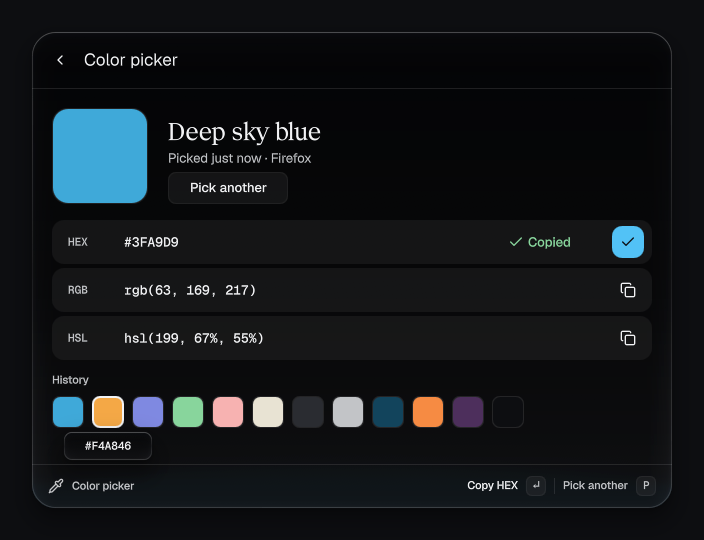 | 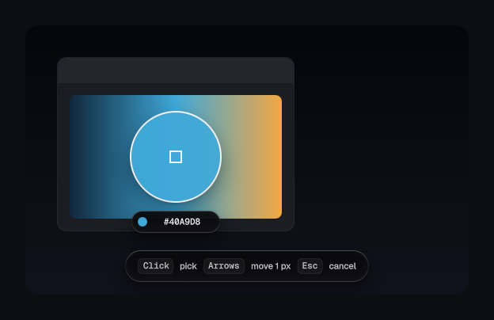 |

Picking a colour freezes the screen and replaces the pointer with a loupe that magnifies the 7 × 7 pixels around it, with the value under the centre pixel shown below. A click picks the colour, the arrow keys move one pixel at a time, Esc cancels.

The result page names the colour after the nearest CSS named colour and shows it in HEX, RGB and HSL, each with a copy button; **Enter** copies the HEX and **P** picks another colour. The history keeps the last twelve colours.

**Status:** passed live QA on Niri (F5), with an open defect. During that QA, picking a colour crashed Quickshell twice. I changed the loupe window to disappear a moment after closing and the crash did not repeat in a sample of two colours, but the same change did not stop the screen capture, which uses the same kind of window, from crashing later that day. I did not find the cause, which is inside Qt, so the loupe can still crash with a real pointer on two monitors. The loupe was not seen on a monitor with a scale other than 1. The loupe picture is a bench scene, since the bench cannot capture the screen.

## Emoji picker

| Grid | Search |
|---|---|
| 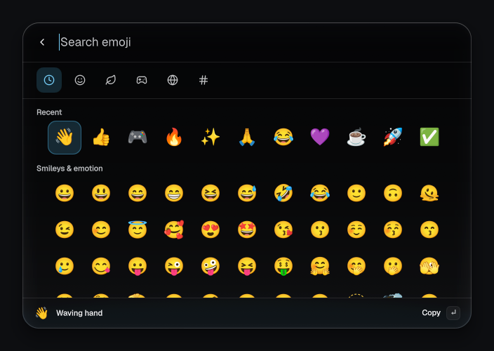 | 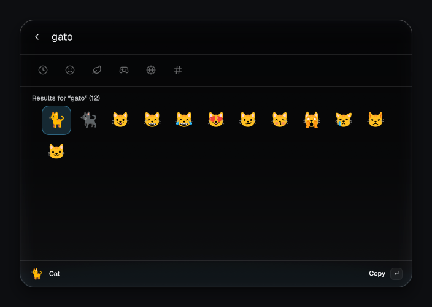 |

A grid of 1,914 emoji from Unicode 17, in colour, with six category tabs and a row of the last eleven I copied. The arrow keys move through the grid, Tab jumps to the next category, and **Enter** copies the selected emoji and closes. Search works in English and in Portuguese, ignores case and accents, and matches at the start of words. Skin tones are not in this version.

**Status:** passed live QA on Niri (F5).

## Clipboard history

| Text | Image |
|---|---|
| 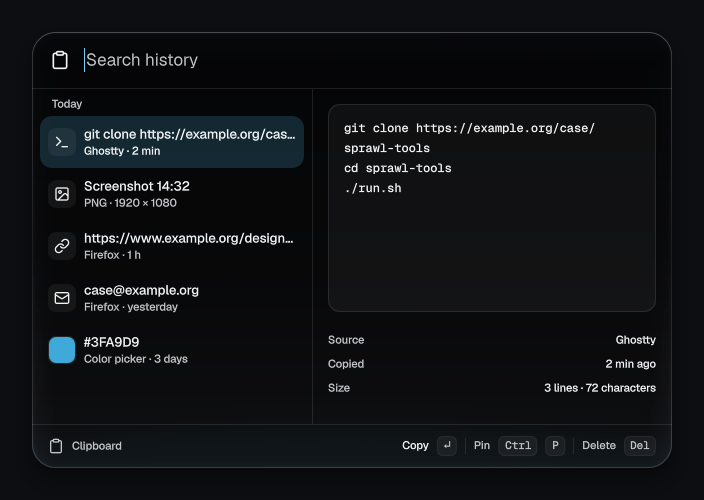 | 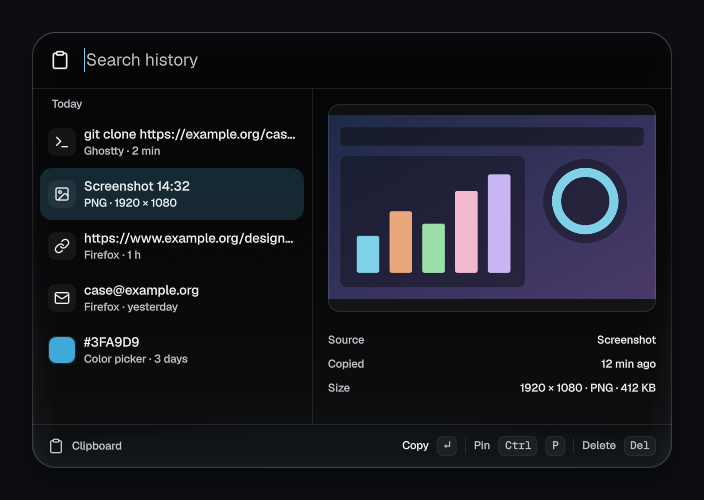 |

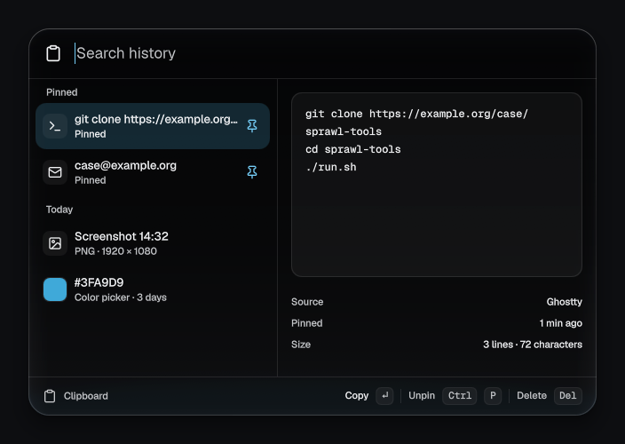

**Super+V** opens the launcher directly on this page; the "Clipboard" chip opens it too. The left column lists what I copied, classified as command, image, link, e-mail, colour or text; the right side previews the selected item with its source app, time and size. **Enter** puts the item back on the clipboard and closes, so I paste with Ctrl+V. **Ctrl+P** pins or unpins, **Del** deletes, and **Ctrl+K** opens the actions menu, which also has "Clear history". Typing filters by text, link, colour and source app.

The history lives only in the session: up to 50 unpinned items, nothing written to disk, and whatever a password manager marks as sensitive is not stored. Only PNG images are kept. The source app is the window that had focus when the item arrived, so it can be wrong.

**Status:** not validated live (F6). The page and the service were tested on the bench and with fabricated input only. Listening to a real clipboard, pasting back, the password-manager hint and copy and paste between Wayland and XWayland apps were never run on Niri.
