# Panels

[Back to the index](README.md)

The panels and pop-ups that open from the sidebar. All of them passed my live QA on Niri in phase F3, and the adjustments that came out of that QA were made in F4. The pictures are in English because the interface moved to English during F4; some demo names are still in Portuguese.

## The card stack

Wi-Fi, Bluetooth and sound share one behaviour. The front card is 316 px wide. When I go one level deeper (a network's details, a pairing code), the new page comes to the front and the previous one stays behind it as a narrower card, dimmed and blurred, showing 32 px above. The hanging button on the top right corner closes the panel, or goes back when there is a page behind. Only one of the three panels is open at a time.

## Wi-Fi

| Network list | Joining a network |
|---|---|
| 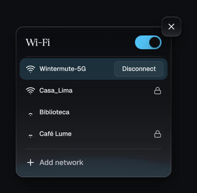 | 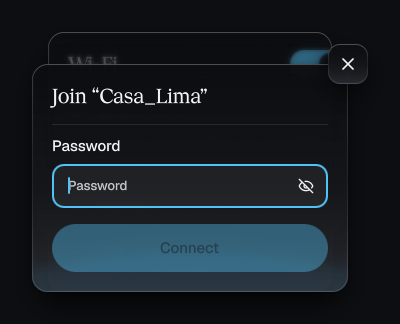 |

| Details | |
|---|---|
| 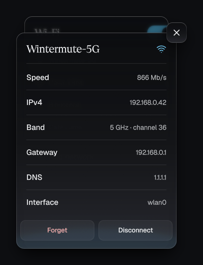 | The list shows the connected network on an accent background with a Disconnect button, then the others with signal and lock icons, and an "Add network" row to enter a network by name, with its security type and a "Hidden network" checkbox. Choosing a protected network opens the password page; the Connect button stays disabled until there is a password. The details page lists speed, IPv4, band, gateway, DNS and interface, with Forget and Disconnect. A short status page ("Connecting…", "Connected", "Incorrect password") follows a connection attempt and closes by itself 1.5 s after connecting. With a cable plugged in, the sidebar button and the list use a cable icon. |

**Status:** passed live QA on Niri (F3).

## Bluetooth

| Device list | Pairing |
|---|---|
| 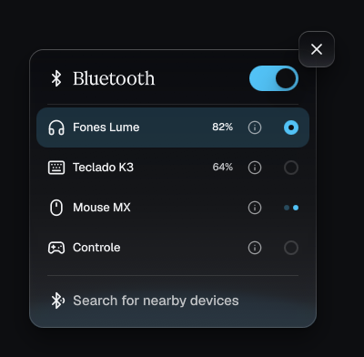 | 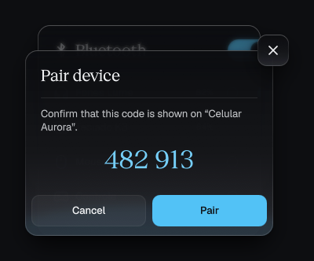 |

Each device row has its icon, name, battery when the device reports it, an info button and a radio that shows whether it is connected; two blinking dots replace the radio while connecting. "Search for nearby devices" opens the list of unpaired devices, and pairing shows the confirmation code in Geist Serif. When the adapter is off, or blocked by `rfkill`, the panel says so; turning the switch on unblocks the radio first and then powers the adapter.

**Status:** passed live QA on Niri. In F3 the radio was blocked on my machine, so the full flow (unblock, list, search, pair) was only validated live in F4.

## Sound

| Chiba | Freeside | Sprawl |
|---|---|---|
|  | 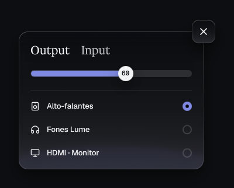 | 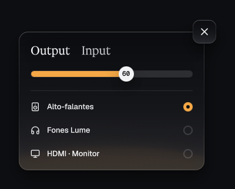 |

Two tabs written as titles, Output and Input; clicking one swaps the list. A volume slider with the value inside the knob, then the PipeWire devices of that kind, each with an icon by type (speakers, headphones, monitor, microphone) and a radio for the selected one. The panel grows with the number of devices.

**Status:** passed live QA on Niri (F3; tab widths adjusted in F4).

## Battery

| Pop-up | Low battery alert |
|---|---|
| 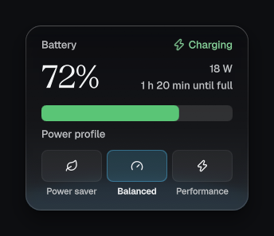 | 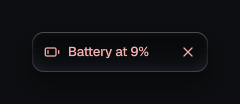 |

The pop-up shows the percentage in Geist Serif, the state (charging, with the wattage and the time until full, or the time left on battery), a charge track, and the three power profiles: Power saver, Balanced and Performance. The track is green while charging and red when the battery is low. The low battery alert appears only with the sidebar collapsed, at the bottom.

**Status:** passed live QA on Niri (F3).

## Calendar

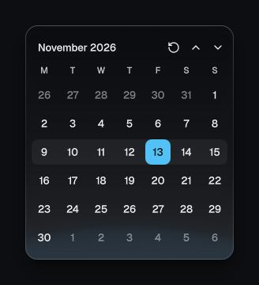

Opens from the clock. A month grid that always has six rows, weeks starting on Monday, today filled with the accent and the current week on a lighter band. Three buttons at the top go back to today, to the previous month and to the next one. Month name and weekday initials follow the system locale.

**Status:** passed live QA on Niri (F3; locale behaviour changed in F4).

## Notification centre and toasts

| Centre | Toast |
|---|---|
| 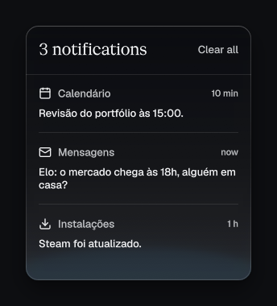 | 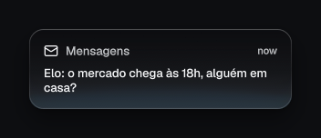 |

The centre opens from the notifications card: a count as the title, "Clear all", and one item per notification with the app icon and name, the time, and up to three lines of text. Hovering an item shows a close button for that one. With the sidebar open, a new notification is previewed inside the [sidebar card](sidebar.md#notifications-card); with the sidebar collapsed, it arrives as a toast like the one on the right.

**Status:** passed live QA on Niri (F3, with the centre's height fixed in F4).

## Appearance

| Chiba | Freeside | Sprawl |
|---|---|---|
| 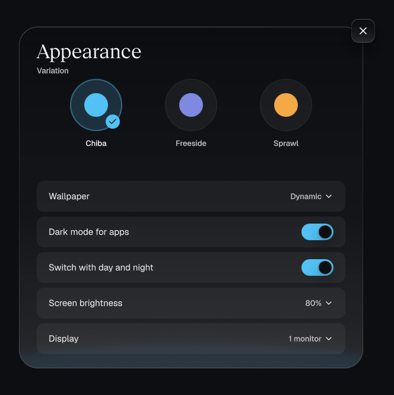 | 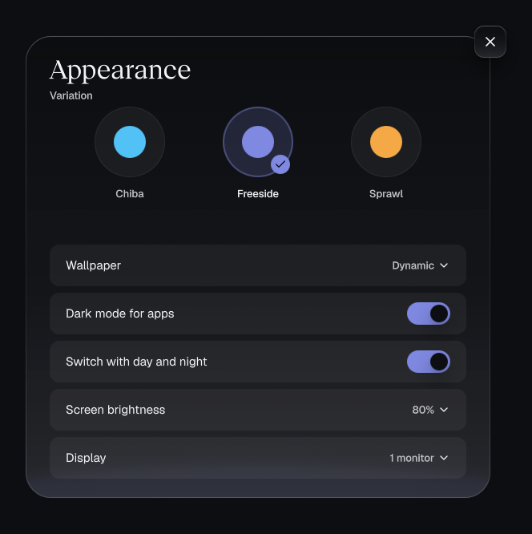 | 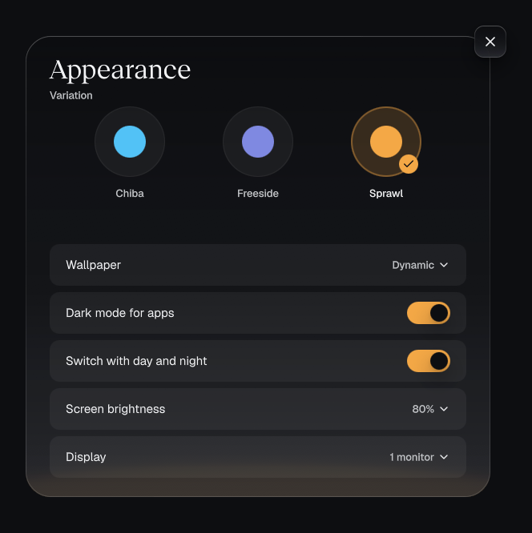 |

Three discs choose the variation; the choice applies at once and is saved. Below them: the wallpaper (which opens the [wallpaper picker](settings.md#wallpaper-picker-and-customize)), two switches for the apps' colour mode, screen brightness (which opens a slider), and the [display page](settings.md#display-and-arrange).

The shell itself is always dark. "Dark mode for apps" sets the light or dark preference that applications read; "Switch with day and night" applies it by the clock, dark from 18:30 to 06:30. The two switches are independent. When brightness cannot be controlled, the row says "Unavailable" and the page explains why.

**Status:** passed live QA on Niri (F3 for the page, F4 for the two switches). One fix was not seen live: the correction of the app colour mode after resuming from suspend, which depends on the lock screen that was never built.

## Not pictured

- **Idle fade.** After the "turn off display" time without input, a black veil fades in over five seconds and then the monitors turn off. Any movement, key or touch cancels it.
