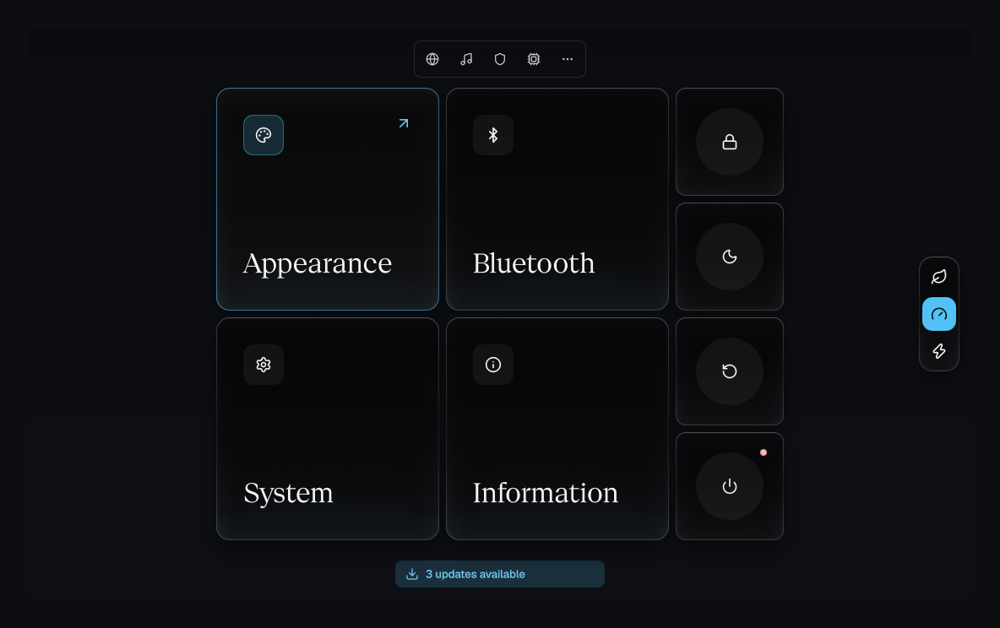
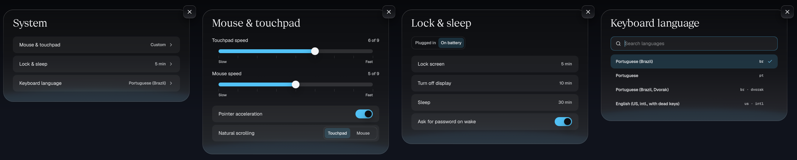
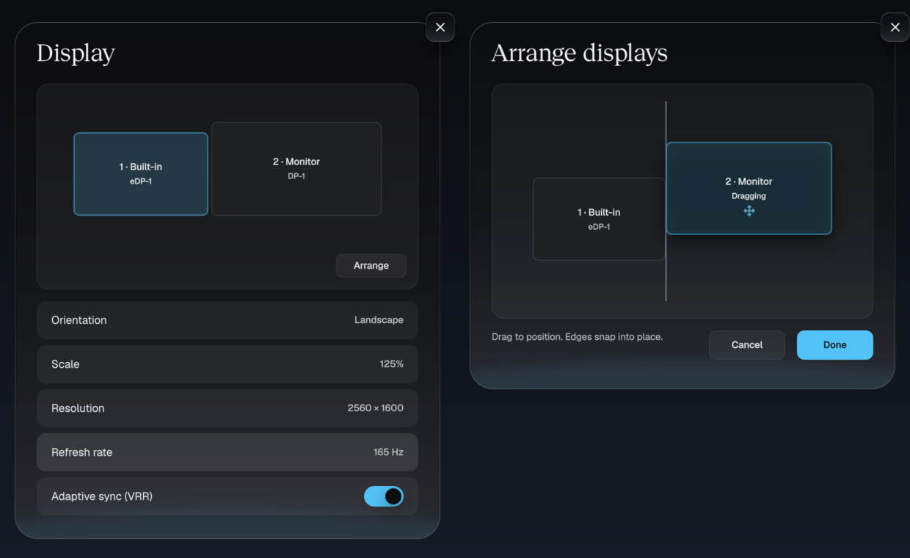
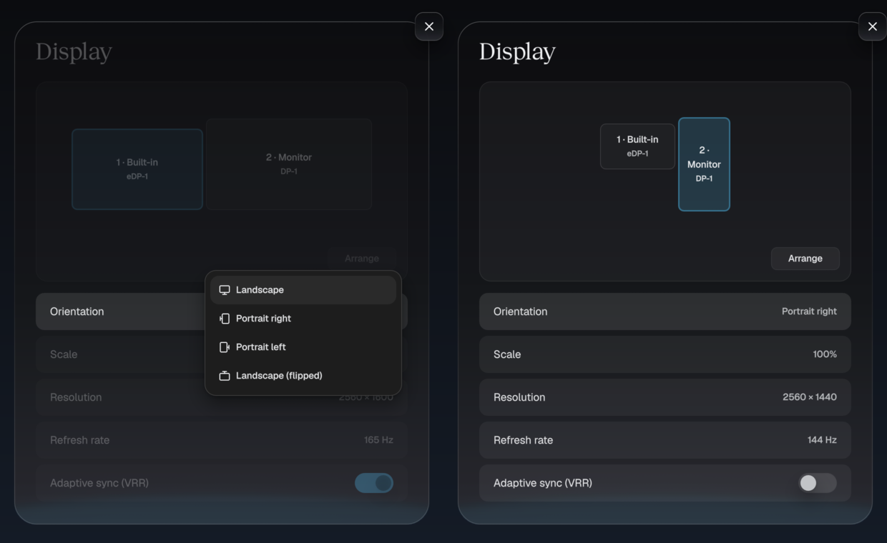
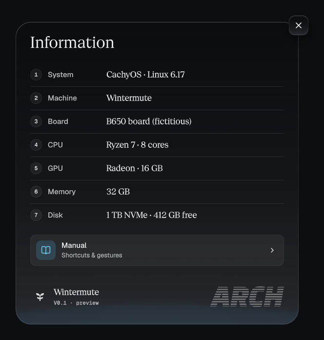
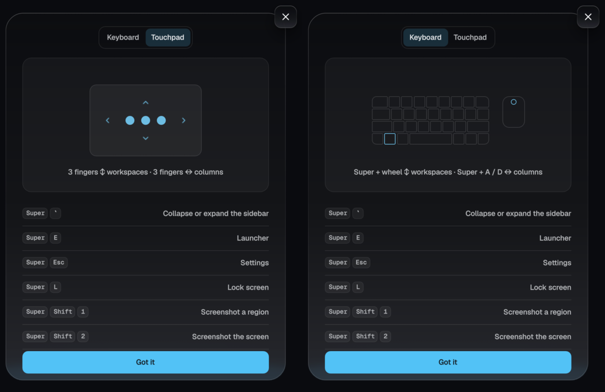
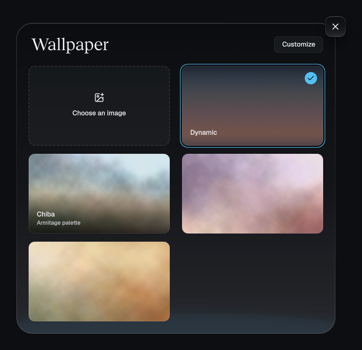
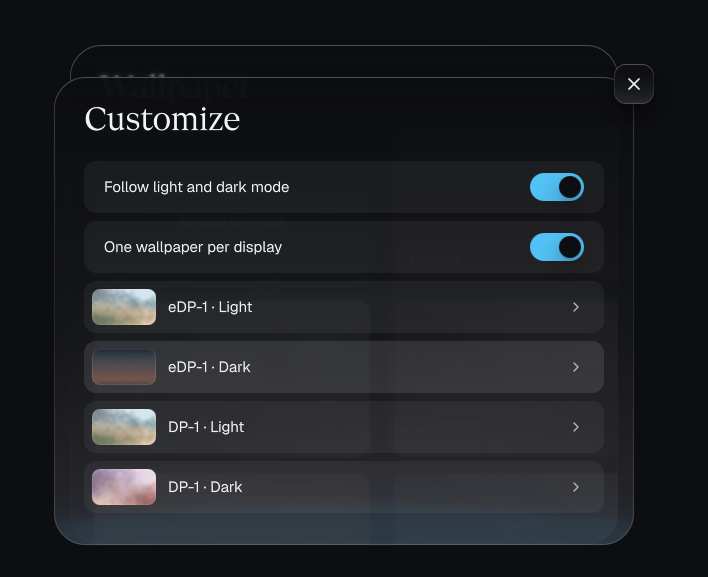
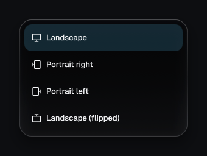
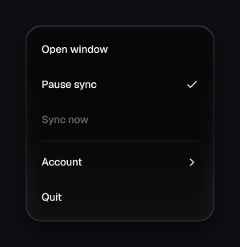

# Settings

[Back to the index](README.md)

The settings screen and its pages. Phase F4 passed my live QA on Niri. The dropdown menu at the end of this page was redrawn later, in F6, and is only partly validated.

**Super+Esc** opens the settings home. The [launcher](launcher.md) also finds every settings page by name and opens it directly.

## Home

A full-screen veil with one composition in the centre: four category cards (Appearance, Bluetooth, System, Information), four session buttons (lock, sleep, restart, power off), the system tray on top, the three power profiles on the right edge, and a badge with the number of available updates at the bottom. Wi-Fi and sound are not here; they stay on the sidebar controls.

Hovering a card lights its rim and icon block in the accent and shows an arrow, as on the Appearance card in the picture. Hovering a session button fills it and shows its name beside it; power off uses the danger colour, the others the accent.

**Status:** passed live QA on Niri (F4). The lock screen was never built: in the launcher, which runs the same session script as these buttons, "Lock screen" and "Sleep" had no effect in live QA.

## System pages

System has three rows, each opening a page:

- **Mouse & touchpad.** One speed slider for the touchpad and one for the mouse, each with nine steps, a switch for pointer acceleration, and natural scrolling per device (each half of the selector toggles its own device).
- **Lock & sleep.** Times for locking the screen, turning off the display and sleeping, separately for "Plugged in" and "On battery", and a switch to ask for the password on wake. Each value opens the dropdown menu.
- **Keyboard language.** A search field and the list of layouts, with the layout code on the right and a check on the current one.

There is no time zone page. Changing the time zone needs administrator authentication, and my Niri session has no polkit prompt to ask for it, so I removed the page and the clock follows the system time.

**Status:** passed live QA on Niri (F4). The password-on-wake switch is stored but only takes effect with the lock screen, which was never built.

## Display and arrange

The Display page draws the monitors and lets me select one; the rows below apply to the selected monitor: orientation, scale, resolution, refresh rate and adaptive sync. The last four only appear when the monitor offers a choice. With more than one monitor, "Arrange" opens a second page where I drag the monitors into position; edges snap, and a thin accent guide marks the shared edge while dragging.

Orientation offers Landscape, Portrait right, Portrait left and Landscape (flipped). Each option carries a small monitor icon rotated the way the screen will end up, and the drawing of the monitors changes shape when it is applied. This picture predates the redrawn dropdown shown [below](#dropdown-menu).

**Status:** passed live QA on Niri (F4).

## Information

Seven numbered rows: system and kernel, machine, board, CPU, GPU, memory and disk, read once each time the page opens. Below them, a button that opens the Manual, and a decorative footer with the provisional sprout mark, the name, the version and an "ARCH" wordmark. The values in the picture are fictitious.

**Status:** passed live QA on Niri (F4). The sprout is a placeholder; the final logo is not designed.

## Manual

The Manual teaches navigation and lists the shortcuts. A selector switches the animated diagram between Keyboard (Super + wheel for workspaces, Super + A / D for columns) and Touchpad (three fingers vertically for workspaces, horizontally for columns). The list below is the same on both tabs and scrolls. It opens by itself the first time the shell runs.

The shortcuts come from one file, which also generates the Niri key bindings, so the Manual and the compositor cannot drift apart. The ones that belong to the shell:

| Shortcut | Action |
|---|---|
| Super+` | Collapse or expand the sidebar |
| Super+E | Launcher |
| Super+Esc | Settings |
| Super+V | Clipboard history |
| Super+Shift+1 | Screenshot a region, with the shell's capture window |
| Super+L | Lock screen (listed, but the lock screen was never built) |

**Status:** passed live QA on Niri (F4).

## Wallpaper picker and Customize

| Picker | Customize |
|---|---|
|  |  |

The picker is a two-column grid. "Choose an image" opens the system file chooser and copies the chosen image into the shell's own folder; "Dynamic" is a sky shader that follows the time of day; then come the three wallpapers of the theme, one per variation, pinned at the top with their names. Images I add come after them and are numbered from 01 in the order they were added. The grid scrolls inside the modal when it grows.

"Customize" opens a card stacked in front of the picker, like the pages of the Wi-Fi panel. It has two independent switches, "Follow light and dark mode" and "One wallpaper per display", and one row per resulting place (for example "eDP-1 · Light"). Clicking a row goes back to the grid to choose the wallpaper for that place. When the apps' colour mode changes, by hand or by the clock, each screen switches to the wallpaper of the new mode.

Neither the numbered tiles nor the Customize card has a design board; I composed them from the components and tokens the shell already uses.

**Status:** passed live QA on Niri (F4). Not seen live: the renumbering of added images when a file leaves the folder.

## Dropdown menu

| Options with icons | Tray menu |
|---|---|
|  |  |

One menu serves the Display rows, the Lock & sleep values and the tray icons on the settings home. It is a glass pop-up with 44 px rows; the current option is tinted with the accent and keeps the keyboard focus when the menu opens. Up and Down skip disabled items and separators, Enter or Space choose, Esc closes. Long lists scroll, with a thin scroll bar.

This menu has no design board either. It kept the look of the code base I started from until F6, when I recomposed it from the shell's own glass, rows and tokens.

**Status:** partly seen live. The Lock & sleep menu opened and worked on Niri; the Display menu, the keyboard keys and the tray menu were not checked, and I have not signed off the new look.
