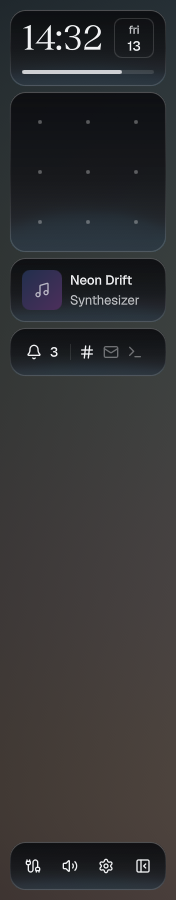
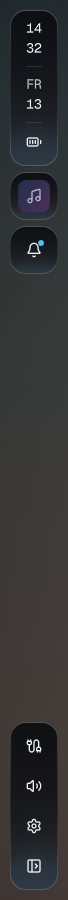
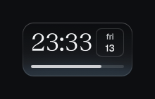
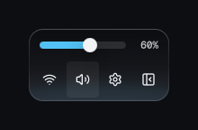
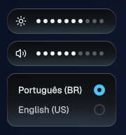
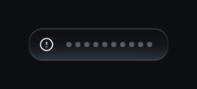

# Sidebar

[Back to the index](README.md)

The sidebar is the part of the shell that is always on screen: two stacks of glass cards on the left edge. Everything on this page passed my live QA on Niri in phases F2 and F3, except where a status line says otherwise.

## The sidebar

| Open (156 px cards) | Collapsed (48 px cards) |
|---|---|
|  |  |

The sidebar window is transparent; only the cards are drawn, and a click between the two stacks goes through to the desktop. The top stack holds the clock, the workspace organizer, the media card and the notifications card. The bottom stack holds the capture preview (when there is one), the brightness OSD and the controls. Cards sit 10 px from the screen edge with 6 px between them.

The corner button or **Super+`** collapses the sidebar from 156 to 48 px in 300 ms, and the windows take the freed space. Only one of the Wi-Fi, sound and Bluetooth panels is open at a time, next to the sidebar.

In these pictures the organizer is an empty card of dots (open) or absent (collapsed): it reads its workspaces from Niri, and the bench runs outside Niri.

**Status:** passed live QA on Niri (F2). The space the sidebar reserves on Niri was changed later, in F6: see [Desktop](desktop.md).

## Clock and battery

The time in Geist Serif, a chip with the weekday and the day, and a thin track with the battery charge. Clicking the time opens the [calendar](panels.md#calendar). Collapsed, the card turns vertical: the hour and the minutes on two lines in Geist Mono, a two-letter weekday, the day, and a battery icon.

The picture shows 23:33 on purpose: it is the widest time in the font, and the size was tuned so it never touches the date chip.

**Status:** passed live QA on Niri (F2, with the font size adjusted in F4).

## Workspace organizer

The central piece of the sidebar. Each workspace is a **row**, and each window is a **circle with the app icon**, in the order of the Niri columns. There are no thumbnails and no tooltips.

- At least three rows are shown; a row shows up to three windows, and scrolls like a carousel when there are more, keeping the focused one in view.
- The active workspace has an accent background, and the focused window an accent ring.
- Hovering the card reveals a pill with the workspace number on each row. Hovering the pill turns it into a handle: dragging it vertically reorders the workspaces.
- Dragging a circle moves that window to another workspace; the window already moves in Niri while I drag, and Esc puts it back.
- On hover, a "+" appears after the last window of the row. It opens the [launcher](launcher.md) on that workspace, so the app I pick is born there. An empty active workspace shows the "+" in its first slot.
- Collapsed, each row is a number; the active workspace stacks its windows as 32 px circles and the others show up to four dots. There is no dragging in the collapsed sidebar.
- A terminal window can show a state icon in place of the app icon: working, needs attention, unread, read. The state is read from the window title.
- Each monitor's sidebar shows only that monitor's workspaces.

I have no bench picture of the organizer with workspaces, because it only has content inside a Niri session. Its empty card is visible in the sidebar picture above.

**Status:** passed live QA on Niri (F2), including dragging windows and reordering workspaces.

## Media

Visible in the sidebar picture above ("Neon Drift"). The card shows the cover, the title and the artist of the active MPRIS player. On hover it grows to reveal previous, play/pause and next. Collapsed, it shows only the cover.

**Status:** passed live QA on Niri (F2).

## Notifications card

At rest the card shows a bell, the count and up to three app icons (see the sidebar picture above). When a notification arrives, the card grows in 300 ms and shows a preview of it, as in this picture. Collapsed, it is a bell with an unread dot in the accent. Clicking it opens the [notification centre](panels.md#notification-centre-and-toasts).

**Status:** passed live QA on Niri (F2 and F3).

## Bottom controls

Four buttons: Wi-Fi, sound, settings and collapse. Bluetooth has no button of its own here: it stays grouped with Wi-Fi, as in the code base I started from, and it also has a card on the [settings home](settings.md#home). Hovering the Wi-Fi button grows the card to show the current download and upload rates; hovering the sound button shows a compact volume slider with the percentage, as in the picture. Collapsed, the four buttons stack vertically.

**Status:** passed live QA on Niri (F2; the percentage next to the slider was added in F4).

## OSDs

| Brightness, volume and keyboard layout | Brightness unavailable |
|---|---|
|  |  |

Brightness and volume share one small card: an icon and ten dots. The value is rounded to the nearest dot, and any value above zero lights at least one. Muted volume shows the muted icon and no dots, and the mute key shows the OSD too. Only one of the two appears at a time, and it stays for 1200 ms after the last key press.

When the brightness key fails (no `ddcutil`, no permission, or a monitor without DDC), the same card appears with an alert icon and no dots; the reason is shown on the Appearance page. The keyboard card lists the layouts with the current one marked, and appears when the layout is switched.

The first picture is cut from an older bench sheet, from before the interface moved to English.

**Status:** passed live QA on Niri (F3 and F4). The "brightness unavailable" state was not seen live, because brightness works on my monitor.

## Not pictured

- **Installs card.** A card in the top stack lists installs in progress, each with a progress ring that becomes a check when it finishes.
